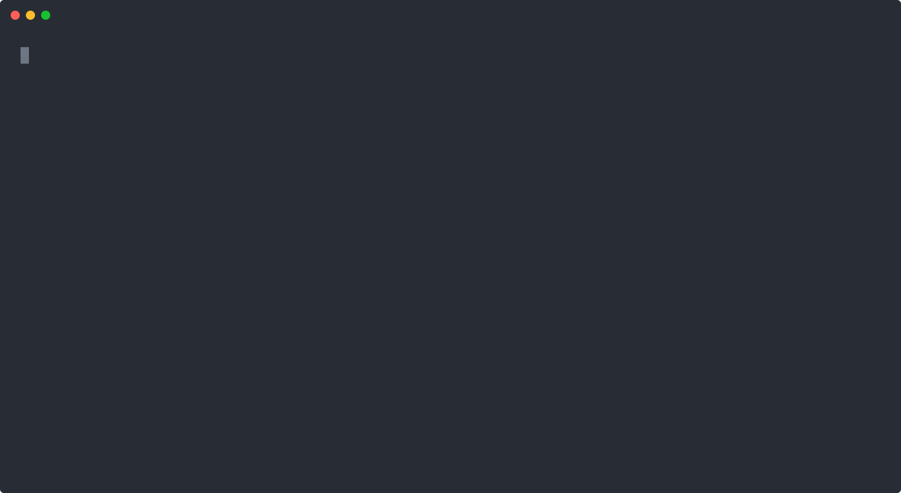

# fevm-replay

[](https://github.com/PugarHuda/fevm-replay/actions/workflows/ci.yml)
[](https://fevm-replay.vercel.app/stateless.html)

**Site and documentation:** https://fevm-replay.vercel.app (mirror: https://pugarhuda.github.io/fevm-replay/)

**Try it first (no install):** [validate a block fresh from the chain's head in your browser](https://fevm-replay.vercel.app/verify.html?block=live): fevm, compiled from Fe to WebAssembly, proves it against every root in its header, and a light client checks its hash: Ethereum's sync committee signed a header that hashes back to it. Or [watch the 3-minute tour](https://fevm-replay.vercel.app/#tour).

**Pitch:** Replay real Ethereum mainnet transactions inside
[fevm](https://github.com/fe-lang/fevm), the EVM written in Fe, and prove
that each one ends exactly as it did on chain: status, gas, logs and every
balance, nonce, code and storage slot.

```
$ fevm-replay range 26394000 20 blocks
block 0x192bd90: 267/267 transactions MATCH (100%)
...
block 0x192bda3: 320/320 transactions MATCH (100%)
20 blocks: 5129/5129 transactions MATCH (100%)
```

Replaying is fast: those 5,129 transactions take 5.9 seconds once fetched.

### For judges: one screen

| | |
| --- | --- |
| **What** | fevm-replay replays real mainnet history in fevm, validates whole blocks statelessly against every root in their headers (what a stateless light client checks, from nothing but the parent's proofs), and checks Fe ports of Solidity contracts against real traffic. All Fe, from the HTTP call to the verdict. |
| **fevm on mainnet** | 115,213 transactions replayed, 290 blocks as chains, no fevm bug; against geth itself (`evm t8n` 1.17.10), 3,100 of 3,100 mutated mainnet calls end the same, and 85 of 85 whole blocks (18,967 transactions) give the header's receipts root, gas and bloom and the proven end state ([more](#fevm-against-geth)) |
| **Stateless** | With the parent's proofs as a witness, fevm runs a block's system calls and transactions and *computes* its `stateRoot`; `transactionsRoot`, `receiptsRoot`, `withdrawalsRoot`, `requestsHash`, `logsBloom` and `gasUsed` come out of fevm too. every block validated so far matched every root (the badge above counts them; 3 consecutive ones as one chain), and `follow` keeps taking more from the chain head; one is checked in CI on every push. A MATCH rests on the block hash, not the node ([details](#every-root-in-the-header)) |
| **For EIP authors** | Measured on 85 mainnet blocks over 5 days ([findings](docs/stateless-findings.md)): code is 45% of a stateless witness; EIP-4762 (Draft) would cost 25% more gas, and 39% of transactions, sent with the same gas limit, would run out of gas. Exempting the coinbase, as the draft exempts the sender and target, brings that to 15%: it saves ETH transfers (60% short, 1.7% exempt) but not contract calls (27%, still 23%: code and storage). Code at half price would bring it to 5.9%, free code to 1.5%. The charges match ethereumjs's independent EIP-4762 implementation on all 18,967 transactions. Under Glamsterdam's execution rules (fevm's `Config::amsterdam()`), the same transactions sent with the same gas limits: 35% would fail, 25% more gas ([more](#every-root-in-the-header)) |
| **Fe ports** | 5 ports (USDT, every Uniswap V2 pair, WETH9, DAI, USDC's proxy) certified by mainnet replay, mainnet mutations, fuzzing and mutation testing ([verified page](https://fevm-replay.vercel.app/verified.html)). Also all four of Ethereum's system contracts (EIP-4788, EIP-2935, EIP-7002, EIP-7251), ported from assembly: on 85 mainnet blocks they store and return what the deployed ones do, and with all four system calls run by the Fe ports every root in the header still matches; the mainnet transactions that call them run identically ([more](#ethereums-own-system-contracts-in-fe)) |
| **Gas vs Solidity** | On 57,034 mainnet calls in identical transactions, the five Fe ports used 3.3% less gas than the deployed solc bytecode; 59 of 61 functions are cheaper (USDT −4.4%, WETH9 −4.0%, DAI −1.6%, pair −1.1%, USDC proxy −1.0%). The system contracts go the other way: hand-written assembly beats them by 24 to 2,026 gas a call ([per function](docs/gas.md)) |
| **Fe-specific** | Effects prove validation needs no file, process or network, so the same Fe compiles to WebAssembly with fevm in it: [validate a whole mainnet block in your browser](https://fevm-replay.vercel.app/verify.html), every root in its header, including a block near the chain's head your browser fetches itself from public nodes, its hash checked by a light client against Ethereum's sync committee signatures, which fevm's own BLS12-381 precompiles verify too (all 85 stateless blocks validate in the module); `const fn` + `static_assert` check the blob fee against a real block; std units, `core::fixed`, `msg`/`recv` ([Fe highlight](#fe-highlight)) |
| **Found** | 4 bugs in the Fe ports (one in our own EIP-7002 port, found by validating a mainnet block on it), 2 node tracer bugs, the transactions the Osaka fork changed, where Fe's code cost more than solc's ([argotorg/fe#2002](https://github.com/argotorg/fe/issues/2002), since fixed in Fe's std), and that Fe's WebAssembly backend emits fevm's tail-call dispatch as plain calls, which overflow a browser's stack ([`web/tailcalls.py`](web/tailcalls.py) works around it), and that even as tail calls each still takes a frame of the module's own 1 MiB stack, so 38 of 51 mainnet blocks trap until it is 64 MiB |
| **Upstream** | fe#2002 led to `Call::forward_delegatecall` in Fe's std ([argotorg/fe#2004](https://github.com/argotorg/fe/pull/2004), merged); our request in [fevm#26](https://github.com/fe-lang/fevm/issues/26) became the operand stack in `Tracer::step` ([fevm#32](https://github.com/fe-lang/fevm/pull/32)); dRPC is deploying a fix for the tracer bug we reported |
| **Beside fevm's chain** | fevm now imports blocks itself ([`fevm_chain`](https://github.com/fe-lang/fevm/tree/main/ingots/chain)), on a full world and its conformance fixtures. fevm-replay is the other half: mainnet blocks, a *partial* world from the parent's proofs, the state root computed from that witness, and Fe ports in place of Solidity. It builds on that fevm and runs each block through `fevm_chain` and `fevm::Block` too: both drivers agree with the header on all 85 blocks ([more](#beside-fevms-chain-layer)) |
| **Watch** | [3-minute tour](https://fevm-replay.vercel.app/#tour) ([`demo/tour-v5.mp4`](demo/tour-v5.mp4)): the site and real terminal runs, driven like a user, with captions, highlights and a neural voice |
| **Try** | No Fe needed: [three commands](#try-it-without-fe) with the release binary; with Node.js alone, `node wasm/cli.mjs` (in the release) validates a block near the head, as the browser page does |

The rest of this README is the full account: [problem](#the-problem),
[approach](#approach), [results](#results), [Fe highlight](#fe-highlight),
[architecture](#architecture), [build](#build-and-test),
[security assumptions](#security-assumptions),
[limitations](#limitations) and [declaration](#declaration).

## The problem

fevm passes all 14,693 runnable Osaka state tests. State tests are
synthetic, though: each one is written to exercise a rule. The way an
execution client earns trust is by replaying real history, where contracts,
bots and wallets combine the rules in ways nobody wrote a test for. fevm had
no way to do that.

The same gap holds for every Fe contract. The Fe team ports Solidity
contracts to Fe (Uniswap v4, Seaport, Liquity v2) to show that Fe can
replace Solidity. The strongest evidence that a port is a drop-in
replacement is real mainnet traffic producing identical results.

## Approach

fevm-replay asks a JSON-RPC node for everything one transaction saw and
did, runs the transaction in fevm, and compares:

1. **Fetch** (`fetch`, `fetch-block`): the transaction, its block and
   receipt, and two `prestateTracer` traces: the accounts and slots the
   transaction read (its pre-state), and in `diffMode` everything it
   changed. A whole block takes five calls: `eth_chainId`, `eth_getBlockByNumber`,
   `eth_getBlockReceipts` and two `debug_traceBlockByNumber`.
2. **Load**: the pre-state becomes an fevm `WorldState`, the transaction a
   `TxRequest` (all five envelope kinds, access lists, blob hashes,
   EIP-7702 authorizations), the header a `BlockEnv`.
3. **Run**: `fevm::transact` executes it under Osaka rules.
4. **Compare**: the expected world is the pre-state with the chain's diff
   applied. fevm-replay compares it with fevm's world **in both
   directions**, so a wrong value and a write the chain never made are both
   caught. It also compares status, gas used and every log.

Everything was built during the contest window; see the declaration below.

## Results

| Run | Transactions | MATCH |
| --- | ---: | ---: |
| 6 hand-picked fixtures (`fixtures/mainnet`) | 6 | 6 |
| Blocks 26,394,000 to 26,394,019 | 5,129 | 5,129 |
| Blocks 26,394,100 to 26,394,199 (99 fetched) | 24,991 | 24,982 |
| Blocks 26,380,000 to 26,380,299 | 85,087 | 84,964 |
| **Total** | **115,213** | **115,081** |

**No transaction exposed a bug in fevm.** Every one of the 132
differences was traced to a cause outside the interpreter, and fevm-replay
now names each cause itself:

| Cause | Differences |
| --- | ---: |
| `BLOCKHASH` of an older block, which the traces cannot carry (labeled) | 91 |
| Inconsistent block traces, matching when fetched again one by one | 37 |
| Answers from different nodes behind one endpoint at the chain head | 3 |
| A node tracer bug (`diffMode` kept an account EIP-6780 deleted) | 1 |
| **Total** | **132** |

Two more causes were fixed in the tool itself: the parent's `BLOCKHASH`
(now from the header) and a delegation target missing from the prestate
(now fetched).
Each cause is explained in [docs/details.md](docs/details.md#every-difference-explained).

`fixtures/negative` holds seven copies of a real transaction, each with one
fact about the chain's result changed: gas, status, a balance, a storage
slot, log data, the log count, and an unexpected write. All seven are
reported as DIFF, which shows the comparison can fail.

`fixtures/malformed` holds twelve broken fixtures (a missing diff, logs that
are not a list, code that is not a string, and so on). Each one is reported
as `ERROR <file>: <what is wrong>`, not a crash. In a block, a transaction
whose trace the node failed (`execution timeout` on a heavy block) is
reported, and the rest still replay.

### fevm against geth

The node's traces say what geth did with the transaction as it was sent.
`fevm_replay fuzz-geth <geth-evm> <dir> <runs> <seed>` asks geth about
transactions nobody sent: it takes a contract call of a saved block, changes
its calldata with the same mutator as `fuzz-block` (one run in four keeps
it), and sends it from a test account whose key geth's `evm t8n` signs with,
on the transaction's own mainnet pre-state and the block's header, under
Osaka. fevm runs the same transaction on the same world ([`src/geth.fe`](src/geth.fe)).
Status, gas used, every log, and every account's balance, nonce and
storage must agree.

On 31 proven blocks, 100 runs each, with geth 1.17.10: **3,100 of 3,100 runs
end the same in both** (2,638 reverted, 462 succeeded). The one difference
the first pass found was the harness's: geth was given the parent block's
hash and fevm was not, and a bot that checks it (step 42) reverted at once
in fevm and ran 18,000 steps in geth.

**Whole blocks through geth.** `fevm_replay geth-block <geth-evm> <dir>...`
gives geth's `evm t8n` a whole mainnet block on the same witness fevm
validates it from: every account and slot the parent's proofs prove (with
the code the tracer saw), the header, its withdrawals and the block hashes
it may read, and the block's own signed transactions. geth's receipts root,
logs bloom, gas used and requests hash must be the header's (fevm's are, on
every validated block), it must reject nothing, and every account and slot
the block's proofs prove after it must be what geth ends with. On all 85
stateless blocks: **85 of 85 agree, 18,967 transactions and 220,617 proven
end values**. The first run differed on one EIP-7702 transaction by 12,500
gas: the harness had put an account the proofs show absent into geth's
allocation, and geth refunds an authority that exists. CI runs it on the
fixture with geth's official 1.17.10 `evm` (sha256-pinned), and refuses the
block with one wei more in a withdrawal.

## Every root in the header

`chain` replays a saved block the way a node does, each transaction on the
state the one before it left. With the block's Merkle proofs saved beside
it (`fetch-proofs`), it validates the block statelessly: fevm starts from
the parent's state root, runs the block's system calls and transactions,
and every commitment in the header has to come out of fevm. Block
26,424,805, saved in [`fixtures/proven`](fixtures/proven) and checked by CI
on every push:

```
$ tar xzf fixtures/proven/0x19335e5.tar.gz -C proven
$ ./out/fevm_replay chain proven/0x19335e5
headers: block 0x633b9caee6ca3358cd64e5f7a20a277125c1a71de9fd2cf855bcb600aed2ccd6 and its parent hash to themselves
pre-state: 210 accounts and 513 slots proven against the parent's state root, 0 differ
system calls: fevm ran EIP-4788 (beacon root) and EIP-2935 (parent hash) before the first transaction
chain proven/0x19335e5: 71/71 transactions MATCH (100%)
receipts: fevm's 71 receipts hash to the header's receiptsRoot
transactions: 71 re-encoded, each hashes to its hash, and they hash to the header's transactionsRoot
withdrawals: 16 hash to the header's withdrawalsRoot
header: fevm's gas (9743588), the blob gas and fevm's logs bloom are the header's gasUsed, blobGasUsed and logsBloom
requests: fevm's 0 deposits, 0 withdrawal and 0 consolidation requests hash to the header's requestsHash
end state: 213 accounts and 521 slots proven against the block's state root, 0 differ
state root: fevm's end state (149 accounts and 521 slots written) on the parent's witness (2969 nodes, 992 KiB) hashes to the header's stateRoot
witness: 448 KiB of it in storage proofs; heaviest storage:
  storage witness 0xdac17f958d2ee523a2206206994597c13d831ec7: 116 KiB, 52 slots
  storage witness 0xa0b86991c6218b36c1d19d4a2e9eb0ce3606eb48: 68 KiB, 31 slots
  storage witness 0xe37a2663cc9c119ba41572c40fab0bbb23a5402f: 39 KiB, 34 slots
  storage witness 0xa6cc3c2531fdaa6ae1a3ca84c2855806728693e8: 34 KiB, 34 slots
  storage witness 0xf02d53d62af4e5c1e0769c36ed0353b29b443c58: 28 KiB, 85 slots
binary tree (EIP-7864), estimated for the same keys: 564 stems, 947 values, 505 to 557 KiB at 28 to 31 levels above the stems (Merkle-Patricia: 1002 KiB)
  plus 26 nodes the parent's proofs lack (9 KiB), siblings a deletion moved up, taken from the block's proofs by the hashes the parent's nodes name
withdrawals: 16 credited, their recipients checked by the end state's proofs
```

| Header field | What fevm-replay matches it with |
| --- | --- |
| `stateRoot` | Computed ([`ingots/replay_core/src/stateless.fe`](ingots/replay_core/src/stateless.fe)): fevm's end state written into the partial trie the parent's proofs witness, then hashed. Also checked key by key against the block's own proofs |
| `transactionsRoot` | Every transaction re-encoded (EIP-2718: legacy, access list, fee market, blob, set code), each hashing to its own hash ([`ingots/replay_core/src/roots.fe`](ingots/replay_core/src/roots.fe)) |
| `receiptsRoot` | fevm's receipts: status, cumulative gas, bloom, every log ([`ingots/replay_core/src/receipts.fe`](ingots/replay_core/src/receipts.fe)) |
| `withdrawalsRoot` | The withdrawals fevm credits |
| `requestsHash` | Deposits cut from fevm's logs, and the EIP-7002 and EIP-7251 system calls run in fevm ([`ingots/replay_core/src/requests.fe`](ingots/replay_core/src/requests.fe)) |
| `parentBeaconBlockRoot`, `parentHash` | Stored by the EIP-4788 and EIP-2935 system calls, run in fevm before the first transaction |
| `gasUsed`, `blobGasUsed`, `logsBloom` | fevm's gas, the blobs, fevm's logs |
| The block hash | The header's RLP, and the parent's, which carries the state root fevm starts from |

**Stateless.** The parent's proofs (EIP-1186) are a witness: the trie
nodes from the parent's state root to every account and slot the block
touched. fevm's end state is written into that partial trie (inserts,
changes, deletions, storage tries too) and hashed again, as a stateless
client validates a block; the result must be the header's `stateRoot`. A
deletion that leaves a branch with one child moves that child up; it may
belong to an untouched key `eth_getProof` cannot name (no free endpoint
serves `debug_executionWitness`): it is then taken from the block's own
proofs by the hash a parent's node names, and counted (26 nodes, 9 KiB,
above). Differential tests check the trie code against a build from
nothing, with inline nodes and merged extensions.

Block 26,424,772 carries an EIP-7002 withdrawal request matched with
`requestsHash`; every validated block, with its witness, is on the
[stateless blocks page](https://fevm-replay.vercel.app/stateless.html).

**Binary tree.** `chain` also estimates the witness EIP-7864's binary tree
would need for the same keys ([`ingots/replay_core/src/binary.fe`](ingots/replay_core/src/binary.fe)): stems and
values exact, stems placed by keccak (the EIP's hash is not fixed yet), 28 to 31 levels deep.
For the block above: 505 to 557 KiB against 1,002 KiB, code left out.

**Code.** `eth_getProof` carries no code, but a stateless client needs
every contract a block runs. While `fevm::Block` runs the block a second
time, a tracer ([`ingots/replay_core/src/chunks.fe`](ingots/replay_core/src/chunks.fe)) notes the 31-byte chunks
each contract's code runs, as EIP-7864 would carry them. Code is 45% of a
full Merkle-Patricia witness (median; 18% to 59%), and a block runs about a
quarter of the code it touches; with code, the binary tree shrinks the
witness 2.0 to 3.3 times.

**Gas.** EIP-4762 (Draft) would charge for that witness
([`ingots/replay_core/src/gas4762.fe`](ingots/replay_core/src/gas4762.fe)): per transaction, for each stem and
leaf read and written, code chunk by chunk, in place of EIP-2929's cold
charges and EIP-2200's SSTORE costs. From each transaction's traces and the
chunks fevm ran, the same blocks would cost 25% more gas (per block −10% to
45%); code, free today, is 50% of the new charges. An ETH transfer would pay
about 5,800 gas more, nearly all for writing the coinbase's balance, which
the draft does not exempt. Exempting it, as the draft exempts the sender and
target, takes the increase to 21%. Sent with the gas limit they had, 39% of
the transactions would run out of gas under the draft, and 15% with the
coinbase exempt: any contract or bot that hard-codes a gas limit breaks. The
exemption saves ETH transfers (60% short, 1.7% exempt), most sent with a
gas limit of exactly 21,000; contract calls stay short (27%, 23% exempt),
from code chunks and storage, though only 170 of 11,642 were sent with no
margin. Eight of 85 blocks would not fit their gas limit as built. After the
coinbase, the price of code decides: with code chunks at half price 5.9% of
transactions would run out of gas, with code free 1.5%. A third of the calls
that stay short go to USDC and USDT: the draft charges for the code chunks
they run, which today's rules do not.

The charging is checked against an independent implementation:
[`docs/eip4762-check`](docs/eip4762-check/compare.mjs) gives the Fe
(`witness_gas`, exported from the WebAssembly module) and ethereumjs
10.1.3's `BinaryTreeAccessWitness` (EIP-4762's costs on EIP-7864's tree,
with its own key derivation) the same accesses for every transaction:

```
EIP-4762 witness gas, Fe vs ethereumjs 10.1.3: 18967/18967 transactions in 85 blocks the same
(972479600 gas; 21559 leaves filled, charged here as ethereumjs does not yet)
```

ethereumjs does not charge the 6,200 for filling a leaf yet, so the leaves
filled are counted from the diff and added. What both sides share is which
accesses the traces show (the approximations above); CI runs the check on
the two fixture blocks.

**Glamsterdam, on today's transactions.** fevm implements Glamsterdam's
execution rules (`Config::amsterdam()`: EIP-8037 and EIP-8038 state gas and
repricing, EIP-2780, EIP-7976 and EIP-7981 transaction repricing, EIP-7708
transfer logs), checked by fevm's CI against execution-spec-tests.
`fevm_replay amsterdam <dir>...` ([`src/amsterdam.fe`](src/amsterdam.fe))
runs every transaction of the saved blocks twice, on the pre-state the node
traced for it and with the gas limit it was sent with: under Osaka, as it
ran, and under Amsterdam.

```
Amsterdam on 85 mainnet blocks: 18967 transactions, each on its own traced pre-state and its own
gas limit; 125 no longer valid, 6693 that succeeded would fail; the rest would use 3007656686 gas
against 2398584215; 8948 transfer logs added (EIP-7708) in 7110 transactions
  ETH transfers: 6625; invalid 0, now failing 1028, ...
  contract calls: 11857; invalid 125, now failing 5503, ...
  contract creations: 25; invalid 0, now failing 21, ...
  blob transactions: 176; invalid 0, now failing 25, ...
  set-code transactions: 284; invalid 0, now failing 116, ...
```

Sent as they were, 35% of these transactions would fail and the rest would
use 25% more gas. The ETH transfers that fail pay a new account into
existence: creating an account is state gas under EIP-8037, and a transfer
sent with exactly 21,000 (or 25,000) cannot cover it
([0xd1163b9a…](https://etherscan.io/tx/0xd1163b9a4766267495dd7f4989552f22108fc05d1fcfb4b436ce7ecf656999aa)).
The 125 no longer valid are contract calls whose gas limit falls below the
new intrinsic cost (the calldata floor of EIP-7976 and EIP-7981). Wallets
that estimate gas would adapt; contracts, bots and scripts that hard-code a
gas limit would not, as with EIP-4762 above. CI checks the count on the
fixture block (1 invalid, 20 now failing of 71).

**Block access lists.** EIP-7928's list for the same blocks, built from
each transaction's traces ([`ingots/replay_core/src/bal.fe`](ingots/replay_core/src/bal.fe)), is 82 KiB a block
(median), 44 times smaller than the witness; with it the longest chain of
transactions each touching what an earlier one wrote is 29% of a block's
transactions, so unlimited cores would need about a third as many steps.

**Who makes the witness big.** Storage is 59% of it; XEN Crypto's trie is
the deepest (8.2 nodes a slot), a USDT or USDC slot needs 7.4 nodes, about
2 KiB. A binary tree shrinks such tries but can grow a small one, whose
slots then each sit on their own path from the root. The findings, with
numbers: [docs/stateless-findings.md](docs/stateless-findings.md).

**Following the chain.** `fevm_replay follow <dir> <out.json> <blocks>`
([`src/follow.fe`](src/follow.fe)) validates the block two behind the head,
again and again, by running itself; the [stateless blocks page](https://fevm-replay.vercel.app/stateless.html)
lists each block's witness, binary estimate and heaviest storage tries.

In every block all transactions and roots match; witness sizes leave
code out. Earlier proofs: [docs/details.md](docs/details.md#proven-against-the-state-root).

**Consecutive blocks as one chain.** Given several block directories,
`chain` validates each and links them: each block's parent is the one
before, whose state root fevm computed and the next pre-state rests on.

```
$ ./out/fevm_replay chain 0x193361d 0x193361e 0x193361f
...
chain of 3 blocks: 2 of 2 links hold (each block's parent is the block before it, and its pre-state was proven against the state root fevm computed for that block)
```

**One wei breaks it.** CI also changes one withdrawal's amount by one wei
in a copy of the fixture: the withdrawals root, the end state's proof and
the computed state root all fail. A node that lied about any balance, slot,
log or transaction would need a keccak collision to pass, so a clean run
rests on one 32-byte block hash that anyone can compare with any source.

## Fe ports, shadow-replayed

Shadow replay runs real mainnet transactions with a Fe port in place of
every account holding the deployed contract's code, and compares
everything, as above. Five Solidity contracts from five compiler versions
are ported; `certify` writes a one-page certificate for each
([verified ports](https://fevm-replay.vercel.app/verified.html)):

| Port | Original | Mainnet txs that ran it | Behaved differently | Mutated mainnet runs that differ | Random calls that differ | Port code reached | Mutants caught | Gas |
| --- | --- | ---: | ---: | ---: | ---: | ---: | ---: | --- |
| USDT | solc 0.4.17 | 21,230 | 0 | 0 of 324,340 | 0 of 1.2M | 97% | 45 of 49 | transfer −4.1% |
| Uniswap V2 pair (every pair) | solc 0.5.16 | 1,687 | 0 | 0 of 513,600 | 0 of 1.2M | 95% | 61 of 74 | swap −0.9% |
| WETH9 | solc 0.4.19 | 6,235 | 0 | 0 of 79,000 | 0 of 1.2M | 89% | 12 of 13 | balanceOf −17.0% |
| DAI | solc 0.5.12 | 10,562 | 0 | 0 of 211,240 | 0 of 120,000 | 95% | 21 of 21 | transfer −1.5% |
| USDC proxy | solc 0.4.24 | 16,597 | 0 | 0 of 27,800 | 0 of 1.2M | 92% | 9 of 12 | transfer −0.7% |

The USDC proxy used to differ twice: through Fe's `MemBuffer` it cost 40
to 60 gas a call more than solc's inline assembly, and two callers with a
tight gas allowance ran out on the port. We reported it
([argotorg/fe#2002](https://github.com/argotorg/fe/issues/2002)); Fe's std
gained `Call::forward_delegatecall`
([argotorg/fe#2004](https://github.com/argotorg/fe/pull/2004)). With it the
port costs 175 to 200 gas a call *less* than the deployed proxy (`transfer`
−0.7%, `balanceOf` −6.3%), and the same 16,597 mainnet transactions behave
identically.

### Ethereum's own system contracts, in Fe

The protocol calls four contracts in every block, all written in assembly:
at the start, EIP-4788's stores the parent beacon root and EIP-2935's the
parent block's hash; at the end, EIP-7002's and EIP-7251's hand the
consensus layer the withdrawal and consolidation requests queued in them,
and move their fee. [`ports/system`](ports/system/src/lib.fe) is all four in
Fe. `fevm_replay system <dir> <BeaconRoots.runtime.bin>
<HistoryStorage.runtime.bin> [<WithdrawalRequests.runtime.bin>
<ConsolidationRequests.runtime.bin>]` runs the ports beside the deployed
contracts on a block's proven state:

- EIP-4788 and EIP-2935: each port must store what the header implies, and
  give the deployed contract's answer to the same 8 reads: a stored and a
  missing timestamp or number, zero, the window's edges, and calldata that
  is too short or too long.
- EIP-7002 and EIP-7251: the end-of-block call runs on the parent's queue,
  and must return the same requests and leave the same queue, excess and
  count. Then come 5 calls on what that call left: a fee read, and requests
  paying the fee, nothing, three times the fee, and one of the wrong length.
  Last, a queue no block had: one request more than a block takes (17 or 3),
  then two end-of-block calls, the second from a head past zero, emptying
  the queue. Every answer, log and storage slot must be the deployed
  contract's.

**Whole blocks on Fe system code.** `fevm_replay chain <dir> --system
<out-dir>` validates a block with all four system calls run by the Fe ports
(built into `out-dir`); the deployed code goes back before the roots are
hashed, since a system call writes storage, never code. On 85 of 85 mainnet
blocks every root still matches the header: the parent beacon root and hash
the ports stored, and the withdrawal and consolidation requests they
returned (11 blocks with consolidations, 3 with withdrawals), hashed into
`requestsHash`. With EIP-2935's code in EIP-4788's place, the state root
fails.

This found a bug that comparing calls had missed: the withdrawal port
returned a request's amount in the byte order it was paid in, where the
deployed contract returns it little-endian, as the consensus layer reads
it. The calls `system` compared used amounts whose bytes read the same both
ways; the first block with a real withdrawal request failed its
`requestsHash`. The port is fixed, and `system`'s calls now use bytes that
differ from position to position, so the old port fails them too.

`fevm_replay mutants-system ports/system <dir>...` plants each of the 66
operator changes in the ports' source, builds each mutant with `fe`, and runs
`system`: on the CI block and three blocks with real requests, 63 of 66 are
caught (60 on the CI block alone, checked in CI). Of the 3 that survive,
two mean the same as the original (a bound where `>` and `>=` agree); one
writes a zero over the next queue slot, which the deployed contract would have left as an old request,
and the proven state does not hold that slot.

Shadow replay runs the mainnet transactions that call these contracts with
the port in place of the deployed one.

| | Mainnet blocks | Block's system call | Calls answered as deployed | Mainnet transactions that called it | Gas (Fe vs deployed) |
| --- | ---: | --- | ---: | ---: | --- |
| EIP-4788 beacon roots | 85 | same slots, every block | 8 of 8, every block | 15 of 15 identical | call +25 (10,076), read +24 |
| EIP-2935 history | 85 | same slots, every block | 8 of 8, every block | none in these blocks | call +55 (5,098) |
| EIP-7002 withdrawal requests | 85 | same output and storage (empty queue every block; 16 dequeued from the synthetic queue) | 5 of 5, every block | 2 of 2 identical | call +133, request +173 |
| EIP-7251 consolidation requests | 85 | same output and storage; 11 blocks dequeued 2 from real queues (6 to 120 deep) | 5 of 5, every block, fees 1 to 2,807 wei | none in these blocks | call +133, 2 dequeued +2,026 |

CI runs the check on a proven block. The ports cost more gas than
hand-written assembly: a few dozen a call at the start of the block, more
for the request contracts, which build their outputs in Fe's `MemBuffer`
(the log is one `CALLDATACOPY`; with it and Fe 26.7 a request went from +712
to +173). The two small ports are about the deployed size (96 bytes against
97, 128 against 83); the request ports are 803 and 748 bytes against 504 and
414.

The full account is in [docs/details.md](docs/details.md): shadow fuzzing,
[every Uniswap V2 pair at once](docs/details.md#every-uniswap-v2-pair-at-once),
[fuzzing from mainnet](docs/details.md#fuzzing-from-mainnet),
[a bug only mainnet callers showed](docs/details.md#a-bug-only-mainnet-callers-showed),
each port, [every label, explained](docs/details.md#every-label-explained),
[where Fe saves gas](docs/details.md#where-fe-saves-gas),
[across the year](docs/details.md#across-the-year),
[a block as one chain](docs/details.md#a-block-as-one-chain),
[how sharp the checks are](docs/details.md#how-sharp-are-the-checks),
[certificates](docs/details.md#one-command-a-port-certificate),
[the GitHub Action](docs/details.md#verified-ports-and-a-github-action)
and the [explorer](docs/details.md#explorer).


## Fe highlight

**The same stateless validation, native and in the browser.** Everything
that validates a block (loading it into fevm, the proofs, the system calls,
the roots, the state root from the witness) is
[`ingots/replay_core`](ingots/replay_core/src/validate.fe): no module there
asks for a file, a process or the network, so it is one ingot for two
targets. The native tool reads a block from disk and calls `validate`;
[`web/`](web/src/lib.fe) builds the same ingot, with fevm itself, with Fe
26.7's `fe build --backend wasm`. On the
[Verify page](https://fevm-replay.vercel.app/verify.html) your browser
downloads a mainnet block (four to pick from, or your own `fetch` +
`fetch-proofs` archive) with its traces and its parent's proofs, and fevm
validates it there. Or it fetches a block a few behind the chain's head
itself, from public nodes that allow it: the block, receipts and prestate
traces from `eth.drpc.org`, then the module's `witness_keys` (the Fe that
decides natively what `fetch-proofs` asks for: CI checks they pick the same
accounts and slots) names what to prove, and `ethereum-rpc.publicnode.com`
sends those proofs, at the parent and at the block. A block of 112
transactions, 300 accounts and 843 slots took 28 seconds from the head to
the verdict; the page offers what it fetched as a `.tar.gz` that
`fevm_replay chain` and `geth-block` check natively. Either way fevm checks
every transaction and every root in the header, as
`fevm_replay chain` prints natively. All 85 blocks of the stateless page
validate in the module, in 0.2 to 12 seconds each in Node.js (median 2.5, every one on the [stateless page](https://fevm-replay.vercel.app/stateless.html)). A receipt
claiming one more gas than its transaction used is caught. Two things stood
in the way. fevm dispatches opcodes as tail calls (each handler calls the
next), which Fe's WebAssembly backend emits as plain calls, so a single
transaction overflowed the browser's stack.
[`web/tailcalls.py`](web/tailcalls.py) rewrites the 66,142 calls that are in
tail position into `return_call` in place, proving from the control flow
that nothing follows them. That frees the engine's stack but not the
module's own stack in linear memory: each handler still takes a frame there
(the cursor is passed by pointer into the caller's frame), so a long run of
opcodes outgrows Fe's default 1 MiB. With it 13 of the 51 blocks validate
and 38 trap with `unreachable`; with `--wasm-stack-size 67108864` all 51
do, and so do the 34 taken since.
CI rebuilds the module with the release binary, rewrites it, checks it is
byte for byte the one the site serves, and validates two blocks with it in
Node.js (`web/test.mjs`), one of which needs the larger stack. Reported as
[argotorg/fe#2056](https://github.com/argotorg/fe/issues/2056), with a
30-line repro; a nightly workflow ([`fe-main-wasm.yml`](.github/workflows/fe-main-wasm.yml))
builds the module with Fe's latest commit twice, with the two workarounds
(the block must validate) and without them, and writes which it is:

```
not yet: block 26,424,772 fails with Fe main 3a6c1647b without the workarounds
(RangeError: Maximum call stack size exceeded)
```

The day that line says FIXED, the workarounds can go. The same page also
walks USDT's and USDC's real account and storage proofs with
[`ingots/mpt`](ingots/mpt/src/lib.fe) and refuses a tampered value.

**The compiler proves the replay cannot touch the network or the disk.**
Fe functions declare the capabilities they use, and native I/O is a
capability like any other. Only the CLI's own modules (`lib`, `fetch`,
`follow`, `geth`, `mutate`) ask for `Spawn` (which starts curl, or geth)
and `Fs`; nothing in `ingots/replay_core` does, which is also why it builds
for the browser. `replay_tx`, which produces the verdict, asks only for a
text buffer to write its report to:

```fe
pub fn replay_tx(
    _ block: BlockEnv,
    parent_hash: u256,
    older_hashes: Value,
    _ tx: Value,
    _ receipt: Value,
    _ prestate: Value,
    _ diff: Value,
    shadow_address: u256,
    shadow_code: MemSpan,
) -> Mismatches
uses (text: mut MemBuffer)
```

Calling `fetch` from inside it would be a type error. So the verdict
provably depends on the node's answers alone, and a fixture replays the same
way on any machine, offline. In most languages that is a convention. In Fe
the type checker enforces it.

**The compiler checks the blob fee schedule against mainnet.** EIP-4844's
blob base fee is a `const fn`, typed with std's units: a `Timestamp` picks
the fork's update fraction and the fee comes out in `Wei`. `static_assert`s
next to it run the fee formula at compile time on a real block, so a wrong
constant or a broken formula does not build:

```fe
pub const fn blob_base_fee(excess: u256, fraction: u256) -> Wei { ... }
pub const fn update_fraction(_ at: Timestamp) -> u256 { ... }

// Block 26,393,604 (BPO2) had 0xb58bccf excess blob gas, and the node
// priced its blobs at 0xb58b03 wei.
static_assert(blob_base_fee(excess: 0xb58bccf, fraction: BPO2_UPDATE_FRACTION).as_wei() == 0xb58b03)
static_assert(update_fraction(BPO1) == BPO1_UPDATE_FRACTION)
```

```
error[8-0081]: static assertion failed
   = left: `11897603`
   = right: `11897604`
```

(what the build says when the expected price is off by one wei).

Other Fe pieces doing real work:

- Every percentage the tool prints (match rates, mutants killed, gas
  changes) is a `core::fixed` number: `UFixed<1>` for shares, `Fixed<1>`
  for signed gas changes. The scale is in the type, so tenths of a percent
  cannot be mixed with whole percents or raw counts.
- A certificate's checks implement one trait, `certify::Check`: each kind
  of result (a replay's totals, mutated runs, random calls, mutation
  testing) says itself what in it fails the port, and the verdict is the
  sum, so a check cannot be left out of it. The certificate opens with a
  line per check.
- Per-function gas is a `Gas` unit of its own (as std's `Wei` is for
  ether): gas adds to gas and divides by a count of calls, and a count
  cannot stand in for gas.
- The ports speak `msg`/`recv`: each declares its ABI as a `msg` with
  selectors, and the contract's `recv` blocks answer it. The ports'
  tests call them through the same `msg` types.
- fevm's `transact` is generic over a `Tracer`. Passing `()` compiles to an
  interpreter without hooks, so plain replays pay nothing for tracing.
- Fe's `#[cfg(target_family = "unix")]` keeps the host-dependent code
  (`std::fs`, `std::process`) out of the library, which type-checks for any
  target.
- Parsing uses [fe-lang/json](https://github.com/fe-lang/json). Execution
  uses fevm's `WorldState`, `TxRequest` and `Receipt`. The whole pipeline,
  from the HTTP call to the verdict, is Fe.

## Architecture

All Fe. `src/fetch.fe` is the only module that reaches the network (curl
through `Spawn`); `src/lib.fe` is the command line. The proof verifier, the
tries, the stateless root, the receipts, transactions, withdrawals and
requests roots, the binary-tree estimate and the EIP-4762 charges use no
host capability at all. Every module and port, one line each:
[docs/details.md](docs/details.md#modules).

### Beside fevm's chain layer

During the contest fevm gained block execution (`fevm::Block`) and a chain
layer (`fevm_chain`: header validation, transaction decoding, Merkle roots,
an incremental `StateTrie`), tested on the execution-spec-tests fixtures.
Its `Chain` holds the whole world, so its state root is the hash of
everything it holds. fevm-replay works where no node keeps the whole state:

| | `fevm_chain` | fevm-replay |
| --- | --- | --- |
| Blocks | conformance fixtures | mainnet, from the chain head |
| World | full | partial: the parent's `eth_getProof` witness |
| `stateRoot` | hash of the whole world | computed from the witness and fevm's end state (`ingots/replay_core/src/stateless.fe`) |
| Beyond the header | | Fe ports shadow-replayed, fuzzing, mutants, witness research (EIP-7864) |

fevm-replay now builds on that fevm, and `chain` runs every block validated
statelessly a second time through fevm's own layer (`ingots/replay_core/src/crosscheck.fe`):
`fevm_chain` decodes the header and validates it against its parent's,
decodes each transaction from its bytes and recovers its sender from the
signature, and hashes the transactions, receipts and withdrawals;
`fevm::Block` runs the system calls, the transactions, the withdrawals and
the request contracts; the state root of `Block`'s end state is computed
from the same witness. Two block drivers on one EVM must agree with the
header, and so with each other:

```
fevm_chain: the header is valid against its parent; 367 transactions decoded from their bytes,
each to its hash and the sender its signature recovers; fevm::Block ran the system calls,
transactions, withdrawals and request contracts; gasUsed, transactionsRoot, receiptsRoot,
logsBloom, withdrawalsRoot, blobGasUsed, requestsHash and, from the witness, stateRoot agree
with the header
```

They agree on all 85 mainnet blocks validated statelessly so far (26,424,722
to 26,464,454, taken on five days), 26,424,772's EIP-7002 withdrawal request among them. One setting is mainnet's own: `Config::osaka()`
carries Osaka's blob schedule (6/9), and mainnet runs BPO2's (14/21, EIP-7892).

### Beside rsp, zeth and light clients

The shape is the one zkVM block provers use: rsp and zeth fetch a block's
witness with `eth_getProof`, execute the block on a partial world (revm in
Rust) inside a guest with no I/O, and check the header's roots. fevm-replay
does the same with an EVM written in Fe, and Fe's effects make "no I/O"
something the compiler checks rather than a convention: the validation
(`ingots/replay_core`) asks for no capability, which is why the same code
builds to WebAssembly and runs in a browser tab.

What rsp and zeth leave to the caller, the block's hash, the browser and
`node wasm/cli.mjs` check as a light client like Helios does
([`site/wasm/lightclient.mjs`](site/wasm/lightclient.mjs), the Altair light
client protocol):

1. Start from one finalized beacon block root written in the code (slot
   15,704,032, 21 Nov 2026), the only thing trusted, and its sync
   committee, proven against that block's state root.
2. Follow each sync committee handoff since: the next committee is proven
   against a header the current one signed (BLS, 2/3 or more of 512).
3. Take the newest header the committee signed (the optimistic update),
   and the execution block proven against its body root.
4. Hash execution headers back from that block to the validated one; each
   header's keccak256 must be the next one's `parentHash`.

```
light client: from the built-in checkpoint 0xa4faecb4… (slot 15704032), 1 sync committee handoff(s),
393/512 signed slot 15704490 (BLS checked by noble and by fevm's own BLS12-381 precompiles,
2 signature(s)) (execution block 26464622), 8 headers hashed back to this block: its hash is the chain's
```

The checkpoint can move forward by the same protocol:
`node web/advance-checkpoint.mjs` walks from it through every handoff to
the latest finalized header and checks that three public checkpoint sync
providers (beaconcha.in, ethstaker, attestant) call the same root
finalized; a weekly workflow ([`checkpoint.yml`](.github/workflows/checkpoint.yml))
runs it, and with `write` commits the newer root.

```
checkpoint 0xa4faecb4… (slot 15704032) -> 0x710a27f2e15b… (slot 15704416): 1 handoff(s),
511/512 signed the finality update, 2 signature(s) also checked by fevm; 3 of 3 checkpoint
sync providers give the same finalized root
```

The rest of the check is what Lodestar's prover does for RPC answers:
every `eth_getProof` answer is proven against a state root in a header
whose hash the light client has just tied to the sync committee's
signatures.

To start from a checkpoint you trust instead (any finalized beacon block
root), pass `--checkpoint 0x…` to `node wasm/cli.mjs` or add
`&checkpoint=0x…` to the page's address. Beacon nodes (publicnode and
Lodestar, both allow the browser) and RPC nodes only supply data. `node web/lightclient-test.mjs` (in CI) replays a
recorded run and checks that 13 lies are each caught: a valid signature
over another header, a signer dropped from the bits, a changed slot,
execution hash or block number, a changed header field or `parentHash`, a
wrong key in either committee, a changed finalized header or checkpoint.
Each sync committee signature is checked twice: by noble (MIT, bundled
into `site/wasm/noble.mjs`), and by fevm itself, with the BLS12-381
precompiles of EIP-2537 that fevm implements in Fe, called through the
module's `precompiles` export: G1 MSM sums the signers' keys,
MAP_FP2_TO_G2 and G2 add hash the signing root to G2, and the pairing
check tests e(keys, H(root)) · e(−G1, signature) = 1. Only what EIP-2537
leaves out runs in JavaScript: decompressing points and hashing to the
field (RFC 9380). The test also has fevm alone refuse a valid signature
over another header and a key set with one signer left out.

## Try it without Fe

Each release carries the executable for x86-64 Linux (or WSL), the ports'
bytecode and the fixtures:

```sh
curl -sL https://github.com/PugarHuda/fevm-replay/releases/latest/download/fevm-replay-v0.8.2-x86_64-linux.tar.gz | tar xz
cd fevm-replay-v0.8.2-x86_64-linux
./fevm_replay fixtures/mainnet/*.json            # 7 real transactions, all MATCH
mkdir proven && tar xzf fixtures/proven/0x19335e5.tar.gz -C proven
./fevm_replay chain proven/0x19335e5             # a mainnet block, every root in its header
./fevm_replay chain proven/0x19335e5 --system ports/system
                                                 # the same block with its four system calls run by the Fe ports
cd ports/system && ../../fevm_replay system ../../proven/0x19335e5 BeaconRoots.runtime.bin   HistoryStorage.runtime.bin WithdrawalRequests.runtime.bin ConsolidationRequests.runtime.bin
                                                 # each Fe system contract beside the deployed one
node wasm/cli.mjs --save                         # Node.js 22+ only: a block near the head, fetched from public
                                                 # nodes and validated by the WebAssembly module the browser runs;
                                                 # --save keeps it, for ./fevm_replay chain
```

Then fetch a live block, prove it and replay it as a chain (needs `curl`):

```sh
B=$(printf '0x%x' $(( $(curl -s -H 'content-type: application/json' --data '{"jsonrpc":"2.0","id":1,"method":"eth_blockNumber","params":[]}' https://eth.drpc.org | grep -o '0x[0-9a-f]*') - 2 )))
./fevm_replay fetch-block $B block && ./fevm_replay fetch-proofs block && ./fevm_replay chain block
```

## Build and test

Native Fe programs build on x86-64 Linux and AArch64 macOS (on Windows, use
WSL). fevm-replay builds on fevm's main branch (its `fevm_chain` layer)
with Fe [v26.7.0](https://github.com/argotorg/fe/releases/tag/v26.7.0)
([`e6e6342b2`](https://github.com/argotorg/fe/commit/e6e6342b252082f3fd8af5b9f763cb13296bf0a1)),
which also carries `Call::forward_delegatecall` for the proxy port. Every
port builds with it, and every certificate is of a 26.7 build. Moving the
pair and DAI to 26.7 took restructuring: 26.7 names each effect by its type,
so a helper can no longer take three `u256` storage fields as three effects,
and it no longer lets `Call` or `Evm` sit beside a `mut` storage effect in
one call ([effects](https://github.com/argotorg/fe/blob/master/docs/language/effects.md)).
The pair's `update` now takes its reserves and price accumulators as `mut`
parameters, and `mint_fee` reads the factory's `feeTo` before it touches
storage; DAI's and the pair's failures revert through
`std::evm::revert_bytes`, which needs no capability. Both were certified
again on the same 200 mainnet blocks, with no behavior difference and the
same mutants caught (61 of 74, 21 of 21).

```sh
# Fe at the pinned commit (needs rustup, a C compiler and the tree-sitter CLI)
rustup toolchain install 1.99.0 --profile minimal
cargo +1.99.0 install --locked --root ~/fe \
  --git https://github.com/argotorg/fe --rev e6e6342b252082f3fd8af5b9f763cb13296bf0a1 --features cranelift fe
export PATH="$HOME/fe/bin:$PATH"

fe --version
fe test --backend native .
fe build --backend native -O 2 --emit executable --out-dir out .

./out/fevm_replay fixtures/mainnet/*.json        # all MATCH
./out/fevm_replay fixtures/negative/gas.json     # DIFF, exit 1
```

Fetching needs `curl` and a node with the `debug` namespace. The default is
the free `https://eth.drpc.org`; pass another URL as the last argument.

## Demo



The recording is [`demo/demo.sh`](demo/demo.sh) (asciinema, svg-term).
Videos: [`demo/tour-v5.mp4`](demo/tour-v5.mp4), the current tour (2:51: a block validated in the browser, geth and fevm_chain agreeing; [`demo/tour-v2.mp4`](demo/tour-v2.mp4) is the one before the system contracts and EIP-4762): Playwright drives the
site like a user, real asciinema recordings of the tool ([`demo/casts`](demo/casts)) play
as terminals, and Remotion adds highlights, zooms, captions and an `edge-tts` voice
([`demo/remotion`](demo/remotion)); [`demo/tour-narrated.mp4`](demo/tour-narrated.mp4) and
[`demo/tour.mp4`](demo/tour.mp4), the earlier tour ([`demo/make_tour.py`](demo/make_tour.py)); [`demo/explorer-tour.mp4`](demo/explorer-tour.mp4),
[the explorer](https://fevm-replay.vercel.app/explorer.html) in 25 seconds.
The same steps by hand are in [docs/details.md](docs/details.md#the-demo-by-hand).

## Security assumptions

What a MATCH or a clean certificate rests on:

- **The node's traces are the reference, unless the block has proofs.**
  Pre-state, receipts and state diffs come from one RPC endpoint. A node
  bug shows up as a DIFF, as several did (see Results); a node that lies
  consistently in its prestate and its diff would go unnoticed by `block`
  and `range`. With `fetch-proofs`, `chain` proves the pre-state and the
  end state against the state roots of headers whose hashes it checks
  and computes the end state's root ([Every root in the
  header](#every-root-in-the-header)), so what it reports rests on the
  block hash alone. fevm's receipts, logs and gas, the transactions and the
  withdrawals are checked against the header for every saved block, with
  or without proofs.
- **A live block's hash rests on a light client.** The browser and
  `node wasm/cli.mjs` check it from one finalized beacon block root in
  `site/wasm/lightclient.mjs` through Ethereum's sync committee signatures
  ([more](#beside-rsp-zeth-and-light-clients)). A checkpoint older than the
  weak subjectivity period (about two weeks of validator churn) should be
  replaced; the native `chain` checks a saved block's headers against each
  other but takes the newest hash from the node.
- **A load-balanced endpoint can mix nodes** near the chain head. Fetch a
  few blocks behind it.
- **Fixtures are trusted input.** A replay reads only the fixture file, and
  the compiler enforces it: the functions that decide MATCH or DIFF do not
  declare the `Spawn` or `Fs` effects (see [Fe highlight](#fe-highlight)).
  A fixture edited by hand replays what it says; malformed ones are rejected
  with a message, not a panic.
- **fevm is the reference EVM for shadow replay and fuzzing.** Both codes
  run in the same fevm, so a fevm bug that hits both the same way is not
  seen there. Plain replays compare fevm with the chain, which is how fevm
  itself is checked.
- **A certificate is evidence, not proof.** It covers the blocks, calls and
  mutants it names. Behavior no transaction, random call or mutation
  reached is not covered; the coverage line says how much of the port ran.
- **Gas- and code-hash-labeled differences are excluded from the verdict**
  only when the call tree shows other code reading the gas left or a code
  hash where the runs part. A port bug that hides behind such a reading
  would be labeled, not counted.
- **The fetcher runs `curl`** with arguments it builds itself from the URL
  and hashes on the command line. It does not run a shell.

## Limitations

- **Block hashes:** `fetch-block` loads only the parent's. `fetch-hashes`
  adds the 256 before a block (86 calls at three a batch), and `range` does
  it by itself for a block whose transactions read one: block 26,400,001
  goes from 446/447 to 447/447.
- **`block` and `range` run each transaction alone**, on its own pre-state
  from the node. `chain` carries state from one transaction to the next,
  credits withdrawals and, with proofs, runs the block's system calls.
- **Stateless validation needs fresh proofs.** Nodes serve `eth_getProof`
  for about 100 blocks back, so `fetch-proofs` must follow the chain head.
  A deletion that moves up a node the parent's proofs lack takes it from
  the block's own proofs (checked by its hash); failing that, the node is
  taken to be a branch and the output counts it (rarely, see the
  findings; every state root still matched). Proofs saved
  before the first system contracts' code was saved fall back to checking
  the end state key by key.
- **Osaka with mainnet's BPO2 blob schedule only.** Older blocks may follow
  other rules.
- Shadow replay and fuzzing have limits of their own, listed in
  [docs/details.md](docs/details.md#limitations-of-shadow-replay-and-fuzzing).
- **Only Osaka.** fevm implements Osaka rules, so exact replays cover blocks
  from December 2025 on. Older blocks replay under Osaka rules as a
  measurement of the fork, not a check of fevm (see
  [Across the year](docs/details.md#across-the-year)).
- **Delegates come from the parent block's state.** A delegation target
  whose code changed within the block would be fetched as it was before.
- **The witness is not compared with a client's.** reth's
  `debug_executionWitness` would give the witness a client builds for the
  same block, but no free public node serves it (drpc, publicnode,
  flashbots and tenderly refused it on 21 Nov 2026).

## Declaration

- **Pre-existing work:** none. The repository starts from
  [fe-lang/builders-challenge-starter](https://github.com/fe-lang/builders-challenge-starter)
  at `f9d9aa9`. Everything after that commit was written during the
  contest.
- **Third-party code:** Fe dependencies are referenced, not vendored:
  - [fe-lang/fevm](https://github.com/fe-lang/fevm): the Fe team states it
    will be Apache-2.0.
  - [fe-lang/json](https://github.com/fe-lang/json) (Apache-2.0).

  Two files in `site/wasm/` are copied from others, unchanged:
  - `host.mjs`: Fe's WebAssembly host, argotorg/fe's
    `examples/wasm/host.mjs` at `e6e6342` (Fe 26.7, Apache-2.0); one line
    added on top saying so.
  - `noble.mjs`: an esbuild bundle of
    [@noble/curves](https://github.com/paulmillr/noble-curves) 1.9.7 and
    [@noble/hashes](https://github.com/paulmillr/noble-hashes) 1.8.0
    (MIT, Paul Miller; license headers kept), for the light client's BLS,
    SHA-256 and keccak.

  `docs/eip4762-check` installs
  [@ethereumjs/evm and @ethereumjs/util](https://github.com/ethereumjs/ethereumjs-monorepo)
  10.1.3 (MPL-2.0) from npm to compare against; nothing of it is copied.
- **AI assistance:** written with Claude (Anthropic) as a pair programmer.
  It drafted the code, which was then checked against the compiler, the
  mainnet results and the negative fixtures. All design choices and results
  were reviewed by the author.

## Team

Pugar Huda Mantoro ([@PugarHuda](https://github.com/PugarHuda)), solo.

## License

Apache-2.0, see [LICENSE](LICENSE).
