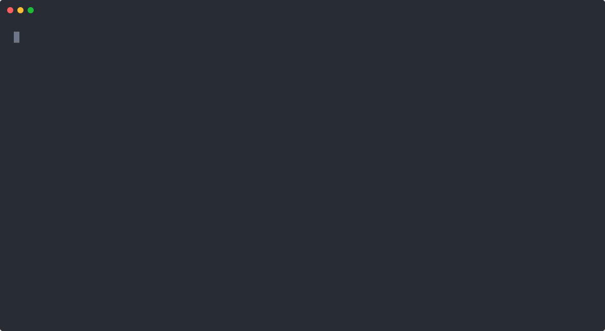

# fevm-replay

[](https://github.com/PugarHuda/fevm-replay/actions/workflows/ci.yml)

**Site and documentation:** https://fevm-replay.vercel.app (mirror: https://pugarhuda.github.io/fevm-replay/)

**Pitch:** Replay real Ethereum mainnet transactions inside
[fevm](https://github.com/fe-lang/fevm), the EVM written in Fe, and prove
that each one ends exactly as it did on chain: status, gas, logs and every
balance, nonce, code and storage slot.

```
$ fevm-replay range 26394000 20 blocks
block 0x192bd90: 267/267 transactions MATCH (100%)
...
block 0x192bda3: 320/320 transactions MATCH (100%)
20 blocks: 5129/5129 transactions MATCH (100%)
```

Replaying is fast: those 5,129 transactions take 5.9 seconds once fetched.

### For judges: one screen

| | |
| --- | --- |
| **What** | fevm-replay replays real mainnet history in fevm, proves the results against the chain's state roots, and checks Fe ports of Solidity contracts against real traffic. All Fe, from the HTTP call to the verdict. |
| **fevm on mainnet** | 115,213 transactions replayed, 290 blocks as chains, no fevm bug |
| **Trust** | With `fetch-proofs`, `chain` proves the pre-state and fevm's end state against the state roots of headers whose hashes it checks; for every saved block it builds the receipts trie from fevm's own receipts and matches the header's `receiptsRoot` (185 of 185 fully matching blocks). A MATCH rests on the block hash, not the node ([details](#proven-against-the-state-root)) |
| **Fe ports** | 5 ports (USDT, every Uniswap V2 pair, WETH9, DAI, USDC's proxy) certified by mainnet replay, mainnet mutations, fuzzing and mutation testing ([verified page](https://fevm-replay.vercel.app/verified.html)) |
| **Fe-specific** | Effects prove the verdict and the proof verifier offline; `const fn` + `static_assert` check the blob fee against a real block; std units, `core::fixed`, `msg`/`recv` ([Fe highlight](#fe-highlight)) |
| **Found** | 3 bugs in the Fe ports, 2 node tracer bugs, the transactions the Osaka fork changed, and where Fe's code costs more than solc's ([argotorg/fe#2002](https://github.com/argotorg/fe/issues/2002)) |
| **Watch** | [3-minute narrated tour](demo/tour-narrated.mp4) |
| **Try** | No Fe needed: [three commands](#try-it-without-fe) with the release binary |

The rest of this README is the full account: [problem](#the-problem),
[approach](#approach), [results](#results), [Fe highlight](#fe-highlight),
[architecture](#architecture), [build](#build-and-test),
[security assumptions](#security-assumptions),
[limitations](#limitations) and [declaration](#declaration).

## The problem

fevm passes all 14,693 runnable Osaka state tests. State tests are
synthetic, though: each one is written to exercise a rule. The way an
execution client earns trust is by replaying real history, where contracts,
bots and wallets combine the rules in ways nobody wrote a test for. fevm had
no way to do that.

The same gap holds for every Fe contract. The Fe team ports Solidity
contracts to Fe (Uniswap v4, Seaport, Liquity v2) to show that Fe can
replace Solidity. The strongest evidence that a port is a drop-in
replacement is real mainnet traffic producing identical results.

## Approach

fevm-replay asks a JSON-RPC node for everything one transaction saw and
did, runs the transaction in fevm, and compares:

1. **Fetch** (`fetch`, `fetch-block`): the transaction, its block and
   receipt, and two `prestateTracer` traces: the accounts and slots the
   transaction read (its pre-state), and in `diffMode` everything it
   changed. A whole block takes five calls: `eth_chainId`, `eth_getBlockByNumber`,
   `eth_getBlockReceipts` and two `debug_traceBlockByNumber`.
2. **Load**: the pre-state becomes an fevm `WorldState`, the transaction a
   `TxRequest` (all five envelope kinds, access lists, blob hashes,
   EIP-7702 authorizations), the header a `BlockEnv`.
3. **Run**: `fevm::transact` executes it under Osaka rules.
4. **Compare**: the expected world is the pre-state with the chain's diff
   applied. fevm-replay compares it with fevm's world **in both
   directions**, so a wrong value and a write the chain never made are both
   caught. It also compares status, gas used and every log.

Everything was built during the contest window; see the declaration below.

## Results

| Run | Transactions | MATCH |
| --- | ---: | ---: |
| 6 hand-picked fixtures (`fixtures/mainnet`) | 6 | 6 |
| Blocks 26,394,000 to 26,394,019 | 5,129 | 5,129 |
| Blocks 26,394,100 to 26,394,199 (99 fetched) | 24,991 | 24,982 |
| Blocks 26,380,000 to 26,380,299 | 85,087 | 84,964 |
| **Total** | **115,213** | **115,081** |

**No transaction exposed a bug in fevm.** Every one of the 132
differences was traced to a cause outside the interpreter, and fevm-replay
now names each cause itself:

- **`BLOCKHASH` of the parent block** (5 in the first run): the prestate
  tracer can't report block hashes, because they are not state. One of these
  transactions even deployed bytecode with the hash baked in, which showed up
  as code of the same size with different bytes. The parent's hash now comes
  from the header.
- **`BLOCKHASH` of an older block** (91): a transaction that differs is run
  a second time under a tracer. If it runs `BLOCKHASH`, it is labeled.
  Given the 256 previous hashes (the `blockHashes` field of a fixture), the
  one checked by hand matches.
- **Answers from different nodes** (3): blocks fetched right at the chain
  head through a load-balanced endpoint. Fetched again, the same block
  matches 391/391. `block` now refuses data whose receipts name another
  block hash than the header.
- **Inconsistent block traces** (37 of the 300-block run): every one of
  them matches when fetched again as a single transaction
  (`debug_traceTransaction`).
- **A gap in the prestate tracer** (seen once): an EIP-7702 transaction
  (`0xbf29…5e33`) calls an account delegated to `0x490a…ca1d`. Running it
  runs that target's code, yet one node's prestate left the target out, so
  fevm found no code and the call did nothing. `fetch` and `fetch-block`
  now add every delegation target missing from the prestate (from the
  authorization list and from `0xef0100` designators), with its code from
  `eth_getCode`, as `delegates`.
  `fixtures/mainnet/eip7702-delegate-missing-from-trace.json` keeps the
  case: it matches with `delegates` and differs without them.
- **A node tracer bug** (1): in transaction
  `0xee56…e697`, a contract deployed with CREATE2 to an address that
  already held ETH destroys itself in the same transaction (EIP-6780).
  `debug_traceBlockByNumber` in `diffMode` reported the account as kept,
  with nonce 1. `debug_traceTransaction` and the chain's own state at that
  block (nonce 0, balance 0, no code) say it was deleted, which is what fevm
  did.

`fixtures/negative` holds seven copies of a real transaction, each with one
fact about the chain's result changed: gas, status, a balance, a storage
slot, log data, the log count, and an unexpected write. All seven are
reported as DIFF, which shows the comparison can fail.

`fixtures/malformed` holds twelve broken fixtures (a missing diff, logs that
are not a list, code that is not a string, and so on). Each one is reported
as `ERROR <file>: <what is wrong>`, not a crash. In a block, a transaction
whose trace the node failed (`execution timeout` on a heavy block) is
reported, and the rest still replay.

## Shadow replay: is a Fe port a drop-in replacement?

`fevm-replay block <dir> <address> <runtime.bin>` replaces the code at
`address` with other runtime code in every transaction that touches it.
For each such transaction it then requires the same logs, balances, nonces
and storage as on chain. Gas may differ, so the sender's fee and the
coinbase's tip are settled by the gas difference first.

[`ports/weth9`](ports/weth9) is WETH9 written in Fe. It keeps the deployed
contract's selectors, events, storage slots (it reads `name` and `symbol`
from their Solidity short-string slots), payable fallback, empty revert
data and ETH transfer gas.

**Shadow replay found a bug in it that unit tests had missed.** Over 300
blocks, 4,806 transactions ran Fe WETH9. In one of them,
`0x4ac9…0f73`, a contract withdraws zero WETH into its own fallback.
Solidity's `msg.sender.transfer(wad)` compiles to a call with
`wad == 0 ? 2300 : 0` gas: the EVM adds the 2,300 gas stipend only to calls
that move ETH, so for zero solc passes it explicitly. The port passed no gas,
the fallback ran out, and the withdrawal reverted where mainnet's did not.
The port now does what solc does, and
`withdrawing_zero_into_a_fallback_succeeds` fails without the fix and
passes with it. Replayed again, the block's 14 WETH transactions are all
identical.

| Fe WETH9 in place of mainnet WETH (300 blocks) | Transactions |
| --- | ---: |
| Ran Fe WETH9 | 4,806 |
| Identical logs and state | 4,348 |
| Differ only where code reads the gas left | 454 |
| Differed in behavior: the zero-withdrawal bug above (now fixed) | 1 |
| Differed in behavior: inconsistent block traces (match per transaction) | 3 |

Shadow replay also measures gas per function. Each shadowed transaction runs
a second time on the deployed code, and a tracer adds up the gas of every
call into WETH by selector. Only transactions the port leaves identical are
counted, so both sides served the same calls. Over blocks 26,394,000 to
26,394,019 (1,631 calls):

| Function | Calls | Deployed Solidity | Fe WETH9 | Change |
| --- | ---: | ---: | ---: | ---: |
| `balanceOf` | 720 | 934 | 806 | −13.7% |
| `transfer` | 441 | 14,207 | 13,745 | −3.2% |
| `transferFrom` | 162 | 11,544 | 11,105 | −3.8% |
| `withdraw` | 140 | 9,619 | 9,360 | −2.6% |
| `deposit` | 104 | 17,237 | 17,109 | −0.7% |
| `approve` | 48 | 16,586 | 16,427 | −0.9% |
| `allowance` | 10 | 2,317 | 2,121 | −8.4% |
| fallback (no calldata) | 4 | 18,956 | 18,972 | +0.1% |

Average gas per call, including the storage and calls each makes. Across the
300-block run, whole transactions that ran Fe WETH9 used 0.42% less gas.

Today's port (address arguments read with `CALLDATALOAD`, as below), over
the same 290 blocks as the other ports: 6,235 transactions ran it, none
behaved differently, and all 510 that differ where code reads the gas left
are explained. `balanceOf` costs 17.0% less, `transfer` 3.8% less.

The 454 are mostly MEV bots that size a builder payment from the gas they
used, and ERC-4337 bundles whose `UserOperationEvent` records it. Cheaper
code legitimately changes what they do. This is detected, not guessed: a
`GasWatch` tracer records whether any other code ran `GAS` after the shadow
code first ran. Only a difference without such a reading counts as the port
behaving differently.

As a control, shadowing WETH with its own deployed bytecode matches every
transaction with identical gas.

### Shadow fuzzing

Mainnet only makes the calls it happens to make. `fuzz` makes the rest: random
calls against two copies of one world, one running the deployed code and one
running the port, compared after every call (status, return data, logs and
all state). Callers include contracts that accept and reject ETH, so
withdrawals into fallbacks are exercised. Everything follows from the seed.

```sh
./out/fevm_replay fetch-code 0xc02aaa39b223fe8d0a0e5c4f27ead9083c756cc2 weth9.hex
./out/fevm_replay fuzz weth9.hex out/weth9/WETH9.runtime.bin 20000 60 1000
```

| Calls (20,000 runs) | Calls | Differ |
| --- | ---: | ---: |
| Well-formed | 945,316 | 0 |
| Calldata shorter than the arguments | 104,530 | 0 |
| Address arguments with dirty upper bits | 150,154 | 0 |

solc 0.4 has no length check: it reads calldata past its end as zeros. So
the port's handlers take no ABI fields; they read their arguments with
`CALLDATALOAD`, which pads with zeros the same way, and keep an address
argument's low 160 bits, as solc does (see
[the bug mainnet showed](#a-bug-only-mainnet-callers-showed)). Every kind of
call matches. The run reaches 639 of the port's 714 instructions (89%). Against the port from before the zero-withdrawal fix, `fuzz` finds that
bug in 0.1 s and prints the call to reproduce it:

```
first difference: seed 34, call 23, selector 0x2e1a7d4d withdraw (well-formed): status differs
  from 0x0000000000000000000000000000000000001000 to 0x0000000000000000000000000000000000002000 value 0
  calldata 0x2e1a7d4d0000000000000000000000000000000000000000000000000000000000000000
  deployed success, port revert
```

### Every Uniswap V2 pair at once

[`ports/uniswap-v2-pair`](ports/uniswap-v2-pair) is UniswapV2Pair written in
Fe: the same selectors, events, storage slots 0 to 12 (with `reserve0`,
`reserve1` and `blockTimestampLast` packed in slot 8), revert reasons and
external calls as the deployed solc 0.5.16 code, including its quirks
(`ds-math-*` reasons, wrapping price accumulators, `transfer` that accepts
tokens returning nothing).

Every Uniswap V2 pair on mainnet runs the same 11,293 bytes. So `block` and
`range` also take a file of deployed code in place of an address, and
shadow **every account running that code** in each transaction:

```sh
./out/fevm_replay fetch-code 0xb4e16d0168e52d35cacd2c6185b44281ec28c9dc pair.hex
(cd ports/uniswap-v2-pair && fe build -O 2 --out-dir ../../out/pair .)
./out/fevm_replay range 26400000 200 blocks pair.hex out/pair/UniswapV2Pair.runtime.bin
```

| Fe UniswapV2Pair in place of every V2 pair (blocks 26,400,000 to 26,400,199, 69,643 transactions) | Transactions |
| --- | ---: |
| Ran the Fe pair | 856 |
| Identical logs and state | 806 |
| Differ only where code reads the gas left | 47 |
| Differ only where code reads code hashes | 3 |
| **Differed in behavior** | **0** |

The code-hash cases are a MEV bot that checks `EXTCODEHASH` of the
pairs it trades through. The port is other code, so its hash differs and the
bot refuses it. Like gas readings, this is detected (other code ran
`EXTCODEHASH` or `EXTCODECOPY`), not guessed.

| Function | Calls | Deployed Solidity | Fe pair | Change |
| --- | ---: | ---: | ---: | ---: |
| `swap` | 873 | 58,307 | 57,766 | −0.9% |
| `getReserves` | 803 | 2,185 | 2,088 | −4.4% |
| `token0` | 49 | 2,136 | 2,063 | −3.4% |
| `factory` | 43 | 2,402 | 2,329 | −3.0% |
| `token1` | 26 | 2,049 | 1,976 | −3.6% |
| `sync` | 7 | 33,498 | 33,902 | +1.2% |

Whole transactions that ran the Fe pair used 0.53% less gas. A first version
of the port used 28% more on `swap`: it read and wrote ABI words a byte at a
time. Shadow replay's per-function gas pointed straight at it.

Mainnet rarely shows a pair's first deposit, a burn of the whole supply or a
reentrant callee, so `fuzz-pair` builds a pair between two tokens running
WETH9's code, a factory with `feeTo` unset or set, and flash-swap callees
that accept or call back into the pair:

```sh
./out/fevm_replay fuzz-pair pair.hex out/pair/UniswapV2Pair.runtime.bin weth9.hex 20000 60 1000
```

| Calls (20,000 runs, 332 s) | Calls | Differ |
| --- | ---: | ---: |
| Well-formed | 989,811 | 0 |
| Calldata shorter than the arguments | 90,177 | 0 |
| Address arguments with dirty upper bits | 120,012 | 0 |

Of the well-formed calls, 9,698 swaps, 8,920 mints and 824 burns succeeded; the rest cover the reverts. The run reaches 3,289 of
the port's 3,466 instructions (94%). Fuzzing found two things mainnet had
not shown:

- **Division by zero.** solc 0.5 divides with `INVALID`, which ends the call
  and burns all its gas. The port's first stand-in reverted instead, which a
  caller can tell apart. Fe has no `INVALID`, so the port now grows memory
  until it runs out of gas: the same exceptional halt.
- **solc 0.5 leaks memory into revert reasons.** After a flash swap, the
  deployed pair reverts with `UniswapV2: INSUFFICIENT_INPUT_AMOUNT` padded
  with a stray `0x80` left in memory by the callback's calldata. The port
  pads with zeros. The reasons are equal, so such calls are counted apart
  (300 in this run), not as differences.

A difference is shrunk: the run is regenerated from its seed and every call
it does not need is dropped, down to the shortest sequence that still
differs. Pair runs also check the port against six of Uniswap V2's
invariants after every call: the lock is released; `k` never falls in a
successful swap; the supply is zero or at least the 1,000 locked; the pair
holds at least its reserve of each token (read from the token's
`balanceOf` slot); neither cumulative price falls; and `kLast` is zero with
the fee off and the reserves' product after every mint or burn with it on.
None broke.

### Fuzzing from mainnet

Random calls in a made-up world miss what real traffic does at the edge.
`fuzz-block` starts from real transactions instead: each one that touches
the deployed code runs, mutated, on its own mainnet pre-state, once with the
deployed code and once with the port, gas free so only behavior can differ.
A mutation changes either the transaction's calldata (exercising the router
or bot that sent it) or, **in flight**, one call the pair really received:
the pair's account runs a small proxy that patches one calldata word and
`DELEGATECALL`s the real code, while the transaction runs unchanged. So a
swap's output is changed with its input tokens already in the pair, the real
router as `msg.sender`, and real tokens (fee-on-transfer, USDT, rebasing)
on the other side.

```sh
./out/fevm_replay fuzz-block blocks/* pair.hex out/pair/UniswapV2Pair.runtime.bin 50 7
```

In flight, the changed call's own status and output decide: callers that
react to gas cannot hide a real difference. Two checks that the oracle
works:

| Ten blocks, 200 mutations per transaction (10,600 runs) | Differ |
| --- | ---: |
| The deployed code against itself | 0 |
| The Fe pair | 0 |
| The Fe pair with a planted bug (0.2% fee instead of 0.3% on one side) | 23 |

Random fuzzing missed the planted bug in 2,000 runs; mainnet's own swaps,
computed by routers right at the 0.3% boundary, find it.

It also found a real bug in the port. In block 26,400,014 a swap pays a
token that burns all the gas it is given, 63/64 of what the pair had. The
deployed pair still reverts with `UniswapV2: TRANSFER_FAILED`; the port ran
out of gas building the same reason through `DynString` and the ABI encoder.
The report pointed at it:

```
  deployed returned 0x08c379a0...556e697377617056323a205452414e534645525f4641494c4544...
  port returned     0x
  runs part at the call to 0x0000000000000000000000000000000000fe11ed selector 0x022c0d9f: deployed revert, port out_of_gas
```

The port now writes its reasons straight to memory as constant words and
reverts with them, as solc does. The first run over 200 blocks (42,800
runs) found 32 differences; this one is fixed and that block now has none.

The rest were the other way round: the deployed pair, costlier, ran out of
gas where the port got through. A change can leave a swap with just enough
gas for the port, or a bot can call with a fixed amount. Such a run is
counted apart when, in flight, both agree given twice the gas, or when the
runs part at a call, same calldata, that ran out of gas on the deployed code
alone. The port running out stays a difference, as above.

| All 200 blocks, 50 mutations per transaction (seed 7) | Runs |
| --- | ---: |
| Mutated | 42,800 |
| Identical | 41,411 |
| Differ where other code reads the gas left or code hashes | 1,276 |
| Differ after an address-shaped word got upper bits | 79 |
| Only the deployed code ran out of gas | 34 |
| **Differ** | **0** |

Of the 20,926 in-flight changes, 19,037 got past the pair's own checks. The
planted bug still shows 23 differences under the same rules.

A mutation can reach state its transaction never touched, which its
prestate does not hold. Given an RPC URL as its last argument, `fuzz-block`
asks the node which accounts and slots each changed calldata touches
(`eth_createAccessList`, no debug namespace needed), reads the missing ones
at the parent block, and applies the state diffs of the block's earlier
transactions, so they hold their values at the moment the transaction ran.
Over 20 blocks with ten mutations per transaction (960 runs), 115 of the
calldata changes reached such state, 213 accounts and slots were fetched
for them, and no run differed. Without fetching, those 115 would have run
on empty values.

Run longer, with 200 mutations per transaction and three seeds over the same
200 blocks:

| 200 blocks × 200 mutations × seeds 7, 8, 9 | Runs |
| --- | ---: |
| Mutated | 513,600 |
| Identical | 497,918 |
| Labeled: the gas left read (all 13,120 explained) or a code hash read (1,240) | 14,360 |
| Only the deployed code ran out of gas | 1,322 |
| **Differ** | **0** |

254,707 of the runs changed a call in flight, and 233,556 of those got past
the pair's own checks.

### A bug only mainnet callers showed

Replaying blocks from across the year turned up one transaction where the
port behaved differently. In block 26,000,008 a bot calls the USDT pair's
`swap` with data packed into the upper twelve bytes of the `to` argument.
solc's ABI decoder keeps the low 160 bits and pays out; Fe's decoder rejected
the word, so the port reverted and the whole transaction with it. The
fuzzers had shown this as "dirty address" differences all along, reported
apart as an expected decoder difference. Mainnet showed that real callers
depend on it.

Both ports now take address arguments as `u256` and keep their low 160 bits,
with the selectors written out (`#[selector = 0x022c0d9f]`), since Fe checks
a `sol(...)` signature against the field types. The block now matches
264/264, and dirty-address calls no longer differ in either fuzzer.

### USDT, the most-called contract

[`ports/usdt`](ports/usdt) is TetherToken (solc 0.4.17) in Fe: all 32
functions of the deployed dispatcher, the same eleven storage slots (with
`owner` and `paused` packed in slot 0, `upgradedAddress` and `deprecated` in
slot 10), the fee and blacklist logic, and the old compiler's failures:
`require` reverts with no data, SafeMath's `assert` runs `INVALID` (the port
grows memory until the gas runs out), and `transfer`, `transferFrom` and
`approve` return nothing. A deprecated token forwards to its successor as
the deployed one does.

```sh
(cd ports/usdt && fe build -O 2 --out-dir ../../out/usdt .)
./out/fevm_replay block blocks/0x192d500 0xdac17f958d2ee523a2206206994597c13d831ec7 out/usdt/TetherToken.runtime.bin
```

| Fe USDT in place of mainnet USDT | 200 blocks | 90 blocks across the year |
| --- | ---: | ---: |
| Transactions that ran the Fe USDT | 16,217 | 5,013 |
| Identical logs and state | 15,571 | 4,850 |
| Differ where code reads the gas left (all explained) | 643 | 163 |
| Only the deployed code ran out of gas | 3 | 0 |
| **Behave differently** | **0** | **0** |

The three that ran out of gas are transfers sent with a tight gas limit: on
chain, USDT ran out of gas and the transaction failed; the port, cheaper,
got through. Replay labels them like `fuzz-block` does: the runs part at a
call with the same calldata that ran out of gas only on the deployed code.

| Function | Calls | Deployed Solidity | Fe USDT | Change |
| --- | ---: | ---: | ---: | ---: |
| `transfer` | 15,969 | 28,123 | 26,968 | −4.1% |
| `balanceOf` | 5,138 | 2,034 | 1,555 | −23.6% |
| `transferFrom` | 2,378 | 22,767 | 21,859 | −4.0% |
| `approve` | 867 | 20,905 | 20,553 | −1.7% |
| `allowance` | 342 | 3,081 | 2,417 | −21.6% |
| `decimals` | 41 | 1,898 | 1,708 | −10.0% |

Whole transactions that ran the Fe USDT used 1.4% less gas. Mutating 1,825
transactions of 20 blocks twenty times each (36,500 runs) finds no
difference. Like the WETH9 port, this one reads its arguments with
`CALLDATALOAD`, and `onlyPayloadSize` stands where the deployed code has it
(after the paused, blacklist and deprecation checks in `transfer`, first in
`approve`), so calldata cut short behaves as on chain. The first run caught a
flaw in the in-flight proxy: it patched every call into the account, so a
transaction that called USDT several times had all of them cut to the
changed call's length. It now patches only calls with the changed call's
selector and length.

Mainnet rarely shows the owner at work, so `fuzz-usdt` builds USDT as
deployed (the first account owns it, every account holds tokens) with two
successors to deprecate to, one answering every call and one reverting, and
calls everything: transfers, approvals and views from any account, and
`issue`, `redeem`, `setParams`, `pause`, `unpause`, the blacklist,
`destroyBlackFunds`, `deprecate` and `transferOwnership`.

```sh
./out/fevm_replay fuzz-usdt usdt.hex out/usdt/TetherToken.runtime.bin 20000 60 1000
```

| Calls (20,000 runs) | Calls | Differ |
| --- | ---: | ---: |
| Well-formed | 989,403 | 0 |
| Calldata shorter than the arguments | 90,160 | 0 |
| Address arguments with dirty upper bits | 120,437 | 0 |

The run reaches 2,541 of the port's 2,610 instructions (97%); mainnet
mutations reach 36%.

### A proxy: USDC's FiatTokenProxy

[`ports/usdc-proxy`](ports/usdc-proxy) is zos's `AdminUpgradeabilityProxy`
(solc 0.4.24) in Fe, the code at USDC's address. It keeps its state at two
hashed slots (`org.zeppelinos.proxy.implementation` and `.admin`) with raw
`sstore`/`sload`, forwards every call to the implementation with
`DELEGATECALL` and returns or reverts with exactly what came back, runs the
admin's functions for the admin only (anyone else calling `admin()` is
forwarded), refuses the admin the fallback with the deployed reason, and
upgrades only to contracts.

| Fe proxy in place of USDC's | 200 blocks | 90 blocks across the year |
| --- | ---: | ---: |
| Transactions that ran it | 12,850 | 3,747 |
| Identical logs and state | 12,087 | 3,582 |
| Differ where code reads the gas left | 761 | 165 |
| **Behave differently** | **2** | **0** |

`fuzz-proxy` puts the admin's functions to work (upgrades to contracts and
to accounts without code, `upgradeToAndCall` with and without data and
value, `changeAdmin`, from the admin and from anyone) in front of WETH9's
code: 1.2 million calls, none different, 92% of the port reached.

The two differences are the port's own cost. Copying calldata and return
data through Fe's `MemBuffer` costs 40 to 60 gas a call more than solc's
inline assembly (`transfer` +0.3%, `balanceOf` +2.1%), and two transactions
call USDC with a gas allowance so tight that the deployed proxy fits and the
port runs out. A port that costs more is a difference, so they stay counted;
it is the one place a Fe port is costlier than the code it replaces.
Reusing one buffer for the calldata and then the return data, as solc
reuses memory from offset 0, does not help through std's public API: the
capacity checks and the truncation cost more than the memory saved (tried
and measured: 53 of 1,390 transactions ran out of gas instead of 0). std
has no public way to copy calldata or return data to a raw offset, which is
the question in [argotorg/fe#2002](https://github.com/argotorg/fe/issues/2002).

### DAI: MakerDAO's stablecoin

[`ports/dai`](ports/dai) is DAI (solc 0.5.12) in Fe: `wards` that may
`mint`, `burn` by holders and spenders, the `push`/`pull`/`move` aliases of
`transferFrom`, unlimited allowances that are never spent, the pre-EIP-2612
`permit` (all or nothing, by signature), and `rely`/`deny` with `LibNote`'s
anonymous log of the call. Its storage is the deployed contract's slot for
slot (`DOMAIN_SEPARATOR` included), its revert reasons the same
`Dai/...` strings.

| Fe DAI in place of mainnet DAI, 200 blocks | |
| --- | ---: |
| Transactions that ran it | 10,562 |
| Identical logs and state | 10,540 |
| Differ where other code reads the gas left | 22 |
| **Behave differently** | **0** |
| Mainnet mutations (20 per transaction) / that differ | 211,240 / **0** |
| Random calls (`fuzz-dai`, signed permits included) / that differ | 120,000 / **0** |
| Mutants killed | 21 of 21 |

The fuzzer signs its own permits: a key it knows (private key 1) holds DAI,
and 72 permits signed by it for mainnet DAI's domain (signed outside with
`eth_keys`, embedded as constants) cover each spender, a current and a
stale nonce, no expiry, a past one, a future one and one equal to the
fuzzer's first block's timestamp. That reaches `permit`'s success path and
its expiry boundary; before, unsigned permits failed at the signature and
two mutants of the expiry check survived. The port's code reached by random
calls went from 89% to 95%.

### Every label, explained

A difference labeled "reads the gas left" is only excused if the gas reading
explains it. Every call is recorded with its caller, the account it runs as
(the caller's, for `DELEGATECALL`), its value and whether its code ran `GAS`
after the port ran. A labeled difference counts as explained when the runs
part at or under a call whose code read the gas left, or, with every call
alike, when the first log or state that differs belongs to such an account.

| Labeled runs | Explained |
| --- | ---: |
| Mainnet mutations, 200 blocks: read the gas left | 1,163 of 1,163 |
| Shadow replay, 200 blocks: read the gas left | 47 of 47 |
| Shadow replay, 90 blocks across the year: read the gas left | 42 of 42 |

Two kinds needed a closer look. A bot that pays the block builder a tip
worked out from `gasleft()` makes the same call with another value: calls now
part on value too. And a contract can emit `gasleft()` in an event through a
`DELEGATECALL`, which is why calls carry the account they run as.

The three code-hash differences are pinned down the same way. Each
transaction is replayed with the port at one shadowed pair at a time, and the
report says whether the port ran at all. In all three, a bot reads the code
hashes of the two pairs it is about to use and reverts with its own error
before calling either: the port never ran, so the difference is the code's
identity, not its behavior.

### Where Fe saves gas

`opgas` charges every opcode of a function the gas it took, on the deployed
code and on the port, over the same mainnet calls (the calls the function
makes are left out). [The chart](https://fevm-replay.vercel.app/opgas.html)
groups them:

```sh
./out/fevm_replay opgas pair.hex out/pair/UniswapV2Pair.runtime.bin 0x022c0d9f blocks/*
```

| Fe minus solc, gas | `swap` (856 calls) | USDT `transfer` (16,217 calls) |
| --- | ---: | ---: |
| Stack shuffling (`POP`, `DUP`, `SWAP`, `PUSH`) | −526,616 | −8,816,663 |
| Arithmetic and logic | −189,343 | −5,866,394 |
| Storage | −217,600 | 0 |
| Control flow | +179,432 | −3,390,675 |
| Memory | +93,179 | +340,083 |
| **Total** | **−2.6%** | **−3.8%** |

Fe moves fewer values around the stack and needs no `EXP` for `2**112`;
it copies calldata and return data into buffers where solc reads them in
place, which is all a proxy does, so the Fe proxy is the one port that costs
more.

The same measurement on all four ports, six functions (blocks 26,400,000 to
26,400,199):

| Function | Calls measured over | Fe vs solc |
| --- | ---: | ---: |
| WETH9 `withdraw` | 3,950 txs | −10.8% |
| USDT `transfer` | 16,217 txs | −3.8% |
| WETH9 `transfer` | 3,950 txs | −3.8% |
| Uniswap V2 `swap` | 856 txs | −2.6% |
| WETH9 `deposit` | 3,950 txs | −0.8% |
| USDC proxy, `transfer` forwarded | 12,850 txs | +1.9% |

| Opcode group, all six | Fe minus solc |
| --- | ---: |
| Stack shuffling | −44.0% |
| Arithmetic and logic | −65.7% |
| Control flow | −28.4% |
| Storage | −0.2% |
| **Memory** | **+25.3%** |

Memory is the one group where Fe spends more, and it does in every one of
the six functions. That is a concrete target for the compiler: the copies of
calldata and return data into `MemBuffer`s that solc avoids.

### Who reads the gas left

[The gas map](https://fevm-replay.vercel.app/gas.html) lists every contract
found this way with all three ports, one at a time, over 200 blocks: 102
contracts in 1,025 explained transactions, with an example of each.

The explained runs name the contracts whose behavior depends on the gas
left. Over 200 blocks of mutations (each batch of 50 blocks lists its ten
most frequent, so these are lower bounds):

| Contract | Runs |
| --- | ---: |
| USDC (`0xa0b8…eb48`) | 246 |
| ERC-4337 EntryPoint v0.8 (`0x4337…f108`) | 235 |
| ERC-4337 EntryPoint v0.7 (`0x0000…a032`) | 149 |
| KyberSwap Meta Aggregation Router v2 (`0x6131…37b5`) | 103 |
| Unknown bot (`0x2cc0…b633`) | 63 |
| Uniswap Universal Router v2.1.2 (`0x2361…de85`) | 45 |
| Uniswap V2 Router02 (`0x7a25…488d`) | 44 |
| Spire Proposer Multicall (`0x9ccc…b294`) | 25 |
| ERC-4337 EntryPoint v0.6 (`0x5ff1…2789`) | 25 |

Account-abstraction entry points meter each user operation with `gasleft()`
and charge for it, so any change in the cost of the code they call changes
what they pay out. USDC's proxy forwards the gas it reads to its
implementation. Routers and bots pass on or check what is left before a
step. A port that is cheaper than the code it replaces is still
distinguishable to all of them, which is why these runs are labeled rather
than counted as differences, and why every label is checked.

### Across the year

fevm implements Osaka, so the spread covers the Osaka era: ten blocks at
each of nine points from 23,940,000 (December 2025, before the BPO1 blob
fork) to 26,300,000 (November 2026), plus the 200 blocks above.

| 90 blocks across the Osaka era | Transactions |
| --- | ---: |
| Replayed | 30,957 |
| MATCH (with every V2 pair replaced by the Fe pair) | 30,915 |
| Ran the Fe pair | 831 |
| Differ where code reads the gas left (all explained) | 42 |
| **Behave differently** | **0** |

Before Osaka, fevm's rules are not the chain's. Replaying Prague blocks
under Osaka rules turns that into a measurement of what the fork changed
for real transactions. Over sixty Prague blocks (13,022 transactions), 48
end differently, and every one is explained by one of three EIPs
([the fork page](https://fevm-replay.vercel.app/fork.html) lists them all):

| Under Osaka | Transactions | |
| --- | ---: | --- |
| EIP-7825: gas limit above 2^24, rejected | 15 | including plain transfers that named more gas than they needed |
| EIP-7883: MODEXP costs more | 16 | five reverted or ran out of gas |
| EIP-7951: P256VERIFY at `0x100` | 17 | smart wallets spent a third to two thirds less gas |

Three examples from the first ten blocks:

| Prague transaction, run under Osaka | What changed | Why |
| --- | --- | --- |
| `0xfc79…5022` | 8,697 more gas | calls MODEXP (`0x05`) five times; EIP-7883 raised its price |
| `0xb5ec…dbd5` | reverts instead of succeeding | calls MODEXP with a gas limit that no longer covers it |
| `0x9a1e…eb6e` | 558,129 gas becomes 281,612; a different log | an ERC-4337 wallet probes `0x100`, empty under Prague, so it verifies a P-256 signature in Solidity; under Osaka EIP-7951 puts the P256VERIFY precompile there |

The first run showed 25 differences in December's blocks: the replay
computed the blob base fee with BPO2's update fraction for every block. It
now picks Prague's, BPO1's or BPO2's by the block's timestamp.

### A block as one chain

`chain` replays a saved block the way a node does: the world starts as the
block's pre-state, each transaction runs on what the one before it left,
and each is checked against the chain's receipt and state diff. After the
last transaction it credits the block's withdrawals (EIP-4895) and, given an
RPC URL, checks every recipient's balance against the node's at the end of
the block.

```sh
./out/fevm_replay chain blocks/0x192d500 https://eth.drpc.org
chain blocks/0x192d500: 88/88 transactions MATCH (100%)
withdrawals: 16 to 4 recipients, 4 balances match the node at the end of the block
```

| 290 blocks replayed as chains | |
| --- | ---: |
| Transactions | 100,600 |
| MATCH, on the state the previous transaction left | 100,585 |
| Read an older block's hash (`BLOCKHASH`) | 14 |
| The node tracer bug above (`0x1d03…0c0f`) | 1 |
| Transactions whose carried state differs from the node's prestate | 0 |
| Withdrawal recipients whose balance matches the node's | 623 of 623 |

Building the block's pre-state took three fixes, each found by a
difference: an account or slot a transaction creates is missing from its
prestate, so the first prestate that lists it already holds a later value
(whatever a diff writes that its prestate does not list is cleared); the
tracer leaves out empty code, so code set later in the block (an EIP-7702
delegation) must not leak back; and an empty account the tracer merely
listed must not exist, or an EIP-7702 authority earns a refund it did not
get on chain. `chain` also checks, before every transaction, that the
carried state holds every value the node's prestate lists.

### Proven against the state root

Everything above trusts the node: its prestate is the starting point, its
diffs and receipts the reference. `fetch-proofs` removes that trust for a
block's state. It saves, beside the block, the Merkle-Patricia proofs
(`eth_getProof`, EIP-1186) of every account and slot the block touched, at
the end of the parent block and of the block itself, with the parent's
header. `chain` then checks, offline:

1. both headers hash (keccak of their RLP) to the block's hash and to its
   parent hash;
2. the pre-state it built from the node's traces against the parent's
   state root, account by account (nonce, balance, code hash) and slot by
   slot; the slots the block's first system calls write (EIP-4788's beacon
   root, EIP-2935's parent hash) are checked against what those calls write;
3. after every transaction and the withdrawals, the state fevm reached
   against the block's own state root;
4. fevm's own receipts (status, cumulative gas, logs bloom and every log),
   encoded as the chain encodes them (EIP-2718), built into a
   Merkle-Patricia trie in Fe ([`src/receipts.fe`](src/receipts.fe)),
   against the header's `receiptsRoot`. This one needs no proofs and no
   node: `chain` checks it for every saved block.

Over the 200 saved blocks (69,643 transactions), fevm's receipts hash to
the header's `receiptsRoot` in every block where all transactions match
(185 of 185). The 14 that do not are the blocks with a transaction that
read an older block's hash, which the traces cannot carry. One block
matches its `receiptsRoot` although a transaction differs:
`0x1d03…0c0f`, the node tracer bug above, where the node's diff keeps an
account that fevm deleted (EIP-6780). The chain's own commitment agrees
with fevm's status, gas and logs for all 257 transactions of that block;
only the node's diff disagrees.

```sh
./out/fevm_replay fetch-block 0x192f3cb blocks/0x192f3cb
./out/fevm_replay fetch-proofs blocks/0x192f3cb      # within ~128 blocks of the head
./out/fevm_replay chain blocks/0x192f3cb
headers: block 0x19f04411…696b and its parent hash to themselves
pre-state: 206 accounts and 673 slots proven against the parent's state root, 0 differ
chain blocks/0x192f3cb: 122/122 transactions MATCH (100%)
end state: 207 accounts and 673 slots proven against the block's state root, 0 differ
withdrawals: 16 credited, their recipients checked by the end state's proofs
```

Block 26,408,299 the same way: 253 accounts and 463 slots proven at both
ends, 126/126 MATCH, 0 differ; its proofs took 1 minute 36 seconds to fetch.
That block is saved in [`fixtures/proven`](fixtures/proven) (4.4 MB): CI
replays it on every push and checks that it proves, and that one wei more
in its saved prestate fails.

So a clean run rests on one 32-byte block hash, which anyone can compare
with any other source, and not on the node that sent the data: a node that
lied about a balance, a slot or a proof would have to find a keccak
collision. Changing one balance in the saved prestate by one wei, or one
byte of one proof node, makes the run fail:

```
DIFF  balance 0x2271adcc…6f92: proven 0x…21db88ec4fe3dd, fevm 0x…21db88ec4fe3de
BROKEN account proof 0xa0b86991c6218b36c1d19d4a2e9eb0ce3606eb48
```

The verifier is `src/proof.fe`, about 300 lines of Fe: RLP from std
(`std::evm::rlp`), keccak from core, a walk down the trie along the key's
64 nibbles through branch, extension and leaf nodes, inline nodes under 32
bytes, and proofs that a key is absent. It uses no effect but a text
buffer for its report, so like the replay it cannot reach the network. Its
tests run on a real proof and header from block 26,407,882.

Nodes keep state for proofs for about 128 blocks (25 minutes), so
`fetch-proofs` must follow `fetch-block` closely. It asks three accounts a
request and four requests at once, which the free endpoint allows for a
block of a few hundred accounts; it then starts answering 429 and holding
answers back, so a busy block (over a thousand accounts) needs an endpoint
of your own, passed as the last argument. The end-of-block request contracts
(EIP-7002, EIP-7251) are not compared, since their system calls are not
run.

### How sharp are the checks?

A check that passes everything proves nothing. `mutants` plants mutants in a
port's source, one operator changed each (`+` for `-`, `<` for `<=`, `==` for
`!=`, `&&` for `||`, ...), builds each with `fe`, and puts it through random
calls and mainnet mutations. The unchanged port goes first and must pass.

```sh
./out/fevm_replay mutants ports/uniswap-v2-pair UniswapV2Pair pair.hex weth9.hex 74 blocks/*
```

| Every operator of the Fe pair (74 mutants), mainnet on 40 blocks | Mutants |
| --- | ---: |
| Killed by random calls | 58 |
| Killed by mainnet mutations | 1 |
| Survived | 15 |

80% are killed. The one only mainnet kills is `_safeTransfer` accepting a
token that returns nothing: the fuzzer's tokens all return `true`, while a
USDT pair on mainnet returns nothing.

The survivors then showed what the fuzzer could not reach, and it learned to:
an account holding 2^113 of each token and transfers that top the pair up
to exactly `UINT112_MAX - 1`, `UINT112_MAX` and one past it, so the
overflow check in `_update` is hit at its edge. That kills the three
overflow mutants and the exact-`k` one: 61 by random calls, 62 with mainnet.

Of the 12 left, 11 change nothing a caller can see, each for a stated
reason: `sqrt` below 4 never runs (a first mint needs a product above 10^6),
a revert reason is never exactly 32 bytes, `min` and `amount_in` agree at
equality, `elapsed >= 0` adds zero to the accumulators, `root_k >=
root_k_last` mints zero, and `last == 0` writes the zero already there. One
is a real blind spot: `liquidity >= 0` would mint zero fee liquidity, which
takes a fee-on pair whose `k` grew by less than six. **62 of the 63
non-equivalent mutants are caught.**

The first run killed 57 (77%). Of the 17 survivors, about half change nothing a caller can
see: `elapsed >= 0` for `elapsed > 0` (a zero adds nothing to the price
accumulators), `x <= y` for `x < y` in `min`, `>=` for `>` against a revert
reason's length, which is never exactly 32. The rest are real blind spots,
listed in the certificate: the exact `k` boundary of `swap`, `permit`'s
deadline at exactly the block's timestamp, `UINT112_MAX` overflow (balances
above 2^112 that no test reaches), small inputs to `sqrt`, and the flash-swap
callback skipped when data is present. The survivors told the fuzzer what to
add: swaps at exactly the most the constant product allows (and one more),
resolved against the state each call runs on; permits whose deadline is the
block's timestamp; and flash swaps to a callee that pays back.

| Port | Operators | Killed |
| --- | ---: | ---: |
| USDT | 49 | 45 (92%) |
| WETH9 | 13 | 12 (92%) |

The WETH9 survivor doubles the length `name()` and `symbol()` decode from
storage, and the fuzzer's world leaves both empty. `mutants ... each <dir>...`
runs the mainnet mutations on every mutant, not only on those random calls
missed, to score them on their own.

### One command: a port certificate

`certify` does all of the above for a port and writes one HTML page: it
builds the port from source with `fe` (and records both code hashes),
replays the saved blocks with the port in place of every copy of the
deployed code, mutates their transactions, fuzzes the port, and plants
mutants. It exits 1 if anything differs, and writes a badge beside the page
(`certificate.svg` for `certificate.html`) for a README.

Each function in the certificate's gas table points at its handler in the
port's source (`src/lib.fe:129` for WETH9's `balanceOf`). Fe at the pinned
commit writes no source map, so the tool follows the selector through the
source: the `msg` variant whose `#[selector = ...]` gives it (`sol(...)`
signatures hashed with keccak, as the compiler does), then the `recv` arm
that runs it (`src/source.fe`).

  

```sh
./out/fevm_replay certify certificate.html pair.hex ports/uniswap-v2-pair UniswapV2Pair weth9.hex 74 blocks/*
```

[The certificate for the Fe pair](https://fevm-replay.vercel.app/certificate.html),
over the 200 blocks with all 74 mutants, took about 25 minutes:

| Fe UniswapV2Pair certificate | |
| --- | ---: |
| Transactions replayed / that ran the port | 69,643 / 856 |
| Behave differently | **0** |
| Mainnet mutations (20 per transaction) | 17,120 |
| &nbsp;&nbsp;labeled, all explained (362 gas, 49 code hash) | 411 |
| &nbsp;&nbsp;only the deployed code ran out of gas | 17 |
| &nbsp;&nbsp;**differ** | **0** |
| Random well-formed calls / that differ | 49,464 / **0** |
| Invariants broken | 0 |
| Port instructions reached: mainnet mutations / random calls | 74% / 95% |
| Mutants killed | 61 of 74 (82%) |

### Verified ports and a GitHub Action

[The verified page](https://fevm-replay.vercel.app/verified.html) puts the
five ports side by side, each with its certificate. Any Fe project can run
the same checks in CI with this repository's action, which builds Fe,
fetches blocks, certifies the port and uploads the page (fails if the port
behaves differently):

```yaml
- uses: PugarHuda/fevm-replay@main
  with:
    deployed: "0xdac17f958d2ee523a2206206994597c13d831ec7"
    port-dir: ports/usdt
    contract: TetherToken
    token: usdt
    first-block: "26400000"
    blocks: "3"
```

[`certify.yml`](.github/workflows/certify.yml) runs it on the USDT port:
two mainnet blocks, 535 transactions, 134 through the port, none different,
in four minutes.

### Explorer

[The explorer](https://fevm-replay.vercel.app/explorer.html) shows five of
these transactions call by call, the deployed code beside the Fe port, with
the call where the runs part marked: the dirty-address bug (switch between
the port before the fix and after it), a bot that checks code hashes, a builder tip worked
out from `gasleft()`, a USDT transfer that runs out of gas only on the
deployed code, and an ordinary swap. Its data comes from `trace`:

```sh
./out/fevm_replay trace blocks/0x192d520 448 pair.hex out/pair/UniswapV2Pair.runtime.bin > trace.json
```

## Fe highlight

**The compiler proves the replay cannot touch the network or the disk.**
Fe functions declare the capabilities they use, and native I/O is a
capability like any other. Only `main` and the `fetch` module ask for
`Spawn` (which starts curl) and `Fs`. `replay_tx`, which produces the
verdict, asks only for a text buffer to write its report to:

```fe
pub fn replay_tx(
    _ block: BlockEnv,
    parent_hash: u256,
    older_hashes: Value,
    _ tx: Value,
    _ receipt: Value,
    _ prestate: Value,
    _ diff: Value,
    shadow_address: u256,
    shadow_code: MemSpan,
) -> Mismatches
uses (text: mut MemBuffer)
```

Calling `fetch` from inside it would be a type error. So the verdict
provably depends on the node's answers alone, and a fixture replays the same
way on any machine, offline. In most languages that is a convention. In Fe
the type checker enforces it.

**The compiler checks the blob fee schedule against mainnet.** EIP-4844's
blob base fee is a `const fn`, typed with std's units: a `Timestamp` picks
the fork's update fraction and the fee comes out in `Wei`. `static_assert`s
next to it run the fee formula at compile time on a real block, so a wrong
constant or a broken formula does not build:

```fe
pub const fn blob_base_fee(excess: u256, fraction: u256) -> Wei { ... }
pub const fn update_fraction(_ at: Timestamp) -> u256 { ... }

// Block 26,393,604 (BPO2) had 0xb58bccf excess blob gas, and the node
// priced its blobs at 0xb58b03 wei.
static_assert(blob_base_fee(excess: 0xb58bccf, fraction: BPO2_UPDATE_FRACTION).as_wei() == 0xb58b03)
static_assert(update_fraction(BPO1) == BPO1_UPDATE_FRACTION)
```

```
error[8-0081]: static assertion failed
   = left: `11897603`
   = right: `11897604`
```

(what the build says when the expected price is off by one wei).

Other Fe pieces doing real work:

- Every percentage the tool prints (match rates, mutants killed, gas
  changes) is a `core::fixed` number: `UFixed<1>` for shares, `Fixed<1>`
  for signed gas changes. The scale is in the type, so tenths of a percent
  cannot be mixed with whole percents or raw counts.
- A certificate's checks implement one trait, `certify::Check`: each kind
  of result (a replay's totals, mutated runs, random calls, mutation
  testing) says itself what in it fails the port, and the verdict is the
  sum, so a check cannot be left out of it. The certificate opens with a
  line per check.
- Per-function gas is a `Gas` unit of its own (as std's `Wei` is for
  ether): gas adds to gas and divides by a count of calls, and a count
  cannot stand in for gas.
- The ports speak `msg`/`recv`: each declares its ABI as a `msg` with
  selectors, and the contract's `recv` blocks answer it. The ports'
  tests call them through the same `msg` types.
- fevm's `transact` is generic over a `Tracer`. Passing `()` compiles to an
  interpreter without hooks, so plain replays pay nothing for tracing.
- Fe's `#[cfg(target_family = "unix")]` keeps the host-dependent code
  (`std::fs`, `std::process`) out of the library, which type-checks for any
  target.
- Parsing uses [fe-lang/json](https://github.com/fe-lang/json). Execution
  uses fevm's `WorldState`, `TxRequest` and `Receipt`. The whole pipeline,
  from the HTTP call to the verdict, is Fe.

## Architecture

| Module | Role |
| --- | --- |
| `src/fetch.fe` | JSON-RPC through curl (`Spawn`), fixtures, block directories and proofs, EIP-4844 blob base fee |
| `src/load.fe` | JSON to fevm: `load_world`, `load_tx`, `load_block` |
| `src/replay.fe` | `replay_tx`: load, `transact`, compare; `trace_tx`; finding the account whose code hash a bot checked. No host capabilities |
| `src/check.fe` | checks the shape of the node's answers before anything reads them |
| `src/compare.fe` | applies the chain's diff, then compares worlds, receipts and logs |
| `src/proof.fe` | Merkle-Patricia proofs (EIP-1186) against a state root, block header hashes, a world checked account by account and slot by slot. No host capabilities |
| `src/receipts.fe` | receipts encoded as the chain encodes them, and a Merkle-Patricia trie built from them, for the header's `receiptsRoot`. No host capabilities |
| `src/fuzz.fe` | shadow fuzzing of WETH9 and of a Uniswap V2 pair: random calls against deployed code and its port, compared after each |
| `src/mutate.fe` | mainnet-seeded fuzzing: real transactions mutated on their own pre-state, calls changed in flight through a proxy |
| `src/watch.fe` | `GasWatch`, a tracer that records every call (caller, account it runs as, value, gas, calldata and output), reads of the gas left after shadow code ran, of code hashes, `BLOCKHASH`, and the port's program counters; where two runs part and which gas reading explains it |
| `src/mutants.fe` | mutation sites in a port's source and the mutants planted there |
| `src/certify.fe` | the certificate page |
| `src/source.fe` | a selector's `msg` variant and `recv` arm in a port's source, for lack of a source map |
| `src/lib.fe` | the CLI: `fetch`, `fetch-block`, `fetch-code`, `fetch-hashes`, `fetch-proofs`, `block`, `range`, `chain`, `trace`, `opgas`, `fuzz`, `fuzz-pair`, `fuzz-usdt`, `fuzz-dai`, `fuzz-proxy`, `fuzz-block`, `mutants`, `certify`, replaying fixture files |
| `src/tests.fe`, `src/proof_tests.fe` | unit tests for the helpers; the proof tests run on a real proof and header from mainnet |
| `ports/weth9` | WETH9 in Fe, for shadow replay |
| `ports/uniswap-v2-pair` | UniswapV2Pair in Fe, for shadow replay of every V2 pair |
| `ports/usdt` | TetherToken (USDT) in Fe |
| `ports/usdc-proxy` | FiatTokenProxy, USDC's upgradeable proxy, in Fe |
| `ports/dai` | DAI (MakerDAO) in Fe, with `permit` and `LibNote` |

## Try it without Fe

Each release carries the executable for x86-64 Linux (or WSL), the ports'
bytecode and the fixtures:

```sh
curl -sL https://github.com/PugarHuda/fevm-replay/releases/latest/download/fevm-replay-v0.1.0-x86_64-linux.tar.gz | tar xz
cd fevm-replay-v0.1.0-x86_64-linux
./fevm_replay fixtures/mainnet/*.json            # 7 real transactions, all MATCH
```

Then fetch a live block, prove it and replay it as a chain (needs `curl`):

```sh
B=$(printf '0x%x' $(( $(curl -s -H 'content-type: application/json' --data '{"jsonrpc":"2.0","id":1,"method":"eth_blockNumber","params":[]}' https://eth.drpc.org | grep -o '0x[0-9a-f]*') - 2 )))
./fevm_replay fetch-block $B block && ./fevm_replay fetch-proofs block && ./fevm_replay chain block
```

## Build and test

Native Fe programs build on x86-64 Linux and AArch64 macOS (on Windows, use
WSL). fevm needs `std::native::sha256_compress`, which landed on Fe master
just after 26.6.0, so this project pins Fe master
[`4608e5fdf`](https://github.com/argotorg/fe/commit/4608e5fdfa3783ec78347f297ad0fced8928fcc7),
the commit fevm itself pins. The Fe team confirmed that pinning master is
fine for the contest.

```sh
# Fe at the pinned commit (needs rustup and a C compiler)
rustup toolchain install 1.99.0 --profile minimal
cargo +1.99.0 install --locked --root ~/fe \
  --git https://github.com/argotorg/fe --rev 4608e5fdfa3783ec78347f297ad0fced8928fcc7 --features cranelift fe
export PATH="$HOME/fe/bin:$PATH"

fe --version
fe test --backend native .
fe build --backend native -O 2 --emit executable --out-dir out .

./out/fevm_replay fixtures/mainnet/*.json        # all MATCH
./out/fevm_replay fixtures/negative/gas.json     # DIFF, exit 1
```

Fetching needs `curl` and a node with the `debug` namespace. The default is
the free `https://eth.drpc.org`; pass another URL as the last argument.

## Demo



The recording is [`demo/demo.sh`](demo/demo.sh), made with asciinema and
svg-term. [`demo/tour-narrated.mp4`](demo/tour-narrated.mp4) is the
narrated tour (under 3 minutes, narration in [`demo/narration.txt`](demo/narration.txt),
spoken by Windows' text-to-speech); [`demo/tour.mp4`](demo/tour.mp4) is the same tour, captioned only:
mainnet replay, blocks proven against state roots, the Fe-specific checks,
the five ports and their certificates, and what was found; its scenes are
HTML pages with real output from these runs, captured in a headless browser
and joined with ffmpeg ([`demo/make_tour.py`](demo/make_tour.py)).
[`demo/tour-captioned.mp4`](demo/tour-captioned.mp4) is the earlier
49-second tour: the verified ports, the bug only
mainnet showed (before and after the fix), the gas map and a certificate.
[`demo/explorer-tour.mp4`](demo/explorer-tour.mp4) is a
25-second tour of [the explorer](https://fevm-replay.vercel.app/explorer.html),
recorded in a headless browser. The same steps by hand:

```sh
./out/fevm_replay fetch 0x9a0970fbbf5df6a17277bc94bf2d96e117d504bd36e341a7ca5230998f916184 usdt.json
./out/fevm_replay usdt.json
./out/fevm_replay fetch-block 0x192bd90 blocks/26394000
./out/fevm_replay block blocks/26394000

# Shadow replay: the same block with Fe WETH9 in place of mainnet WETH
(cd ports/weth9 && fe build -O 2 --out-dir ../../out/weth9 .)
./out/fevm_replay block blocks/26394000 0xc02aaa39b223fe8d0a0e5c4f27ead9083c756cc2 out/weth9/WETH9.runtime.bin

# Many blocks: fetches what is missing (five calls a block), replays, totals.
# Run it again to resume; saved blocks are not fetched twice.
./out/fevm_replay range 26394000 20 blocks
./out/fevm_replay range 26394000 20 blocks 0xc02aaa39b223fe8d0a0e5c4f27ead9083c756cc2 out/weth9/WETH9.runtime.bin
```

## Security assumptions

What a MATCH or a clean certificate rests on:

- **The node's traces are the reference, unless the block has proofs.**
  Pre-state, receipts and state diffs come from one RPC endpoint. A node
  bug shows up as a DIFF, as several did (see Results); a node that lies
  consistently in its prestate and its diff would go unnoticed by `block`
  and `range`. With `fetch-proofs`, `chain` proves the pre-state and the
  end state against the state roots of headers whose hashes it checks
  ([Proven against the state root](#proven-against-the-state-root)), so
  what it reports rests on the block hash alone. fevm's receipts and logs
  are checked against the header's `receiptsRoot` for every saved block,
  with or without proofs. Transactions are still the node's: they are not
  checked against `transactionsRoot`.
- **A load-balanced endpoint can mix nodes** near the chain head. Fetch a
  few blocks behind it.
- **Fixtures are trusted input.** A replay reads only the fixture file, and
  the compiler enforces it: the functions that decide MATCH or DIFF do not
  declare the `Spawn` or `Fs` effects (see [Fe highlight](#fe-highlight)).
  A fixture edited by hand replays what it says; malformed ones are rejected
  with a message, not a panic.
- **fevm is the reference EVM for shadow replay and fuzzing.** Both codes
  run in the same fevm, so a fevm bug that hits both the same way is not
  seen there. Plain replays compare fevm with the chain, which is how fevm
  itself is checked.
- **A certificate is evidence, not proof.** It covers the blocks, calls and
  mutants it names. Behavior no transaction, random call or mutation
  reached is not covered; the coverage line says how much of the port ran.
- **Gas- and code-hash-labeled differences are excluded from the verdict**
  only when the call tree shows other code reading the gas left or a code
  hash where the runs part. A port bug that hides behind such a reading
  would be labeled, not counted.
- **The fetcher runs `curl`** with arguments it builds itself from the URL
  and hashes on the command line. It does not run a shell.

## Limitations

- **Block hashes:** `fetch-block` loads only the parent's. `fetch-hashes`
  adds the 256 before a block (86 calls at three a batch), and `range` does
  it by itself for a block whose transactions read one: block 26,400,001
  goes from 446/447 to 447/447.
- **`block` and `range` run each transaction alone**, on its own pre-state
  from the node. `chain` carries state from one transaction to the next and
  credits withdrawals, but does not run the block's system calls (EIP-4788,
  EIP-2935) or the end-of-block requests (EIP-7002, EIP-7251).
- **Osaka with mainnet's BPO2 blob schedule only.** Older blocks may follow
  other rules.
- **Shadow replay sees gas-sensitive code.** Code that reads `GAS` after the
  shadow code ran may legitimately act differently. Such transactions are
  labeled rather than counted as port bugs. So are transactions where other
  code ran `EXTCODEHASH` or `EXTCODECOPY`, since a port is other code. The
  opcode's target is not checked, so a label can be broader than the cause.
- **The ports decode calldata strictly** where old solc did not: Fe WETH9
  rejects missing arguments Solidity 0.4 read as zero, and both reject
  address arguments with dirty upper bits that solc cleaned. No transaction
  in the replayed blocks relied on either.
- **The Fe pair halts on division by zero by running out of gas**, where
  solc 0.5 runs `INVALID`. Both burn all the call's gas; a tracer sees a
  different reason.
- **Mainnet fuzzing reads untouched state as empty.** Accounts and slots
  the original transaction did not touch are not in its pre-state; a
  mutation that wanders off sees them empty in both runs, which is fair
  but not realistic.
- **Code-hash and gas labels are checked afterwards, not at the opcode.**
  fevm's tracer does not expose the stack, so the target of `EXTCODEHASH` is
  found by replaying with the port at one account at a time, and a gas
  reading is tied to a difference through the call tree.
- **Untouched state is fetched only on request, and only for calldata
  changes.** Without an RPC URL a mutation that reaches a slot its
  transaction never touched sees it empty in both runs. With one,
  `eth_createAccessList` names what the changed calldata touches, at the
  parent block: a slot reached only because an earlier transaction in the
  same block changed the path is not named. In-flight changes are not
  fetched, since the proxy that makes them is not on chain.
- **Only Osaka.** fevm implements Osaka rules, so exact replays cover blocks
  from December 2025 on. Older blocks replay under Osaka rules as a
  measurement of the fork, not a check of fevm (see
  [Across the year](#across-the-year)).
- **Delegates come from the parent block's state.** A delegation target
  whose code changed within the block would be fetched as it was before.

## Declaration

- **Pre-existing work:** none. The repository starts from
  [fe-lang/builders-challenge-starter](https://github.com/fe-lang/builders-challenge-starter)
  at `f9d9aa9`. Everything after that commit was written during the
  contest.
- **Third-party code:** none copied. Dependencies are referenced, not
  vendored:
  - [fe-lang/fevm](https://github.com/fe-lang/fevm): the Fe team states it
    will be Apache-2.0.
  - [fe-lang/json](https://github.com/fe-lang/json) (Apache-2.0).
- **AI assistance:** written with Claude (Anthropic) as a pair programmer.
  It drafted the code, which was then checked against the compiler, the
  mainnet results and the negative fixtures. All design choices and results
  were reviewed by the author.

## Team

Pugar Huda Mantoro ([@PugarHuda](https://github.com/PugarHuda)), solo.

## License

Apache-2.0, see [LICENSE](LICENSE).
