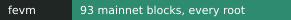

# fevm-replay

[](https://github.com/PugarHuda/fevm-replay/actions/workflows/ci.yml)
[](https://fevm-replay.vercel.app/stateless.html)

**Site and documentation:** https://fevm-replay.vercel.app (mirror: https://pugarhuda.github.io/fevm-replay/)

**Pitch:** Replay real Ethereum mainnet transactions inside
[fevm](https://github.com/fe-lang/fevm), the EVM written in Fe, and prove
that each one ends exactly as it did on chain: status, gas, logs and every
balance, nonce, code and storage slot.

```
$ fevm-replay range 26394000 20 blocks
block 0x192bd90: 267/267 transactions MATCH (100%)
...
block 0x192bda3: 320/320 transactions MATCH (100%)
20 blocks: 5129/5129 transactions MATCH (100%)
```

Replaying is fast: those 5,129 transactions take 5.9 seconds once fetched.

### For judges: one screen

| | |
| --- | --- |
| **What** | fevm-replay replays real mainnet history in fevm, validates whole blocks statelessly against every root in their headers, and checks Fe ports of Solidity contracts against real traffic. All Fe, from the HTTP call to the verdict. |
| **fevm on mainnet** | 115,213 transactions replayed, 290 blocks as chains, no fevm bug |
| **Stateless** | With the parent's proofs as a witness, fevm runs a block's system calls and transactions and *computes* its `stateRoot`; `transactionsRoot`, `receiptsRoot`, `withdrawalsRoot`, `requestsHash`, `logsBloom` and `gasUsed` come out of fevm too. every block validated so far matched every root (the badge above counts them; 3 consecutive ones as one chain), and `follow` keeps taking more from the chain head; one is checked in CI on every push. A MATCH rests on the block hash, not the node ([details](#every-root-in-the-header)) |
| **Fe ports** | 5 ports (USDT, every Uniswap V2 pair, WETH9, DAI, USDC's proxy) certified by mainnet replay, mainnet mutations, fuzzing and mutation testing ([verified page](https://fevm-replay.vercel.app/verified.html)) |
| **Fe-specific** | Effects prove the verdict and the proof verifier offline; `const fn` + `static_assert` check the blob fee against a real block; std units, `core::fixed`, `msg`/`recv` ([Fe highlight](#fe-highlight)) |
| **Found** | 3 bugs in the Fe ports, 2 node tracer bugs, the transactions the Osaka fork changed, and where Fe's code cost more than solc's ([argotorg/fe#2002](https://github.com/argotorg/fe/issues/2002), since fixed in Fe's std) |
| **Upstream** | fe#2002 led to `Call::forward_delegatecall` in Fe's std ([argotorg/fe#2004](https://github.com/argotorg/fe/pull/2004), merged); our request in [fevm#26](https://github.com/fe-lang/fevm/issues/26) became the operand stack in `Tracer::step` ([fevm#32](https://github.com/fe-lang/fevm/pull/32)); dRPC is deploying a fix for the tracer bug we reported |
| **Beside fevm's chain** | fevm now imports blocks itself ([`fevm_chain`](https://github.com/fe-lang/fevm/tree/main/ingots/chain)), on a full world and its conformance fixtures. fevm-replay is the other half: mainnet blocks, a *partial* world from the parent's proofs, the state root computed from that witness, and Fe ports in place of Solidity. It builds on that fevm and runs each block through `fevm_chain` and `fevm::Block` too: both drivers agree with the header on all 35 blocks ([more](#beside-fevms-chain-layer)) |
| **Watch** | [3-minute tour](demo/tour-v2.mp4): the site and real terminal runs, driven like a user, with captions, highlights and a neural voice |
| **Try** | No Fe needed: [three commands](#try-it-without-fe) with the release binary |

The rest of this README is the full account: [problem](#the-problem),
[approach](#approach), [results](#results), [Fe highlight](#fe-highlight),
[architecture](#architecture), [build](#build-and-test),
[security assumptions](#security-assumptions),
[limitations](#limitations) and [declaration](#declaration).

## The problem

fevm passes all 14,693 runnable Osaka state tests. State tests are
synthetic, though: each one is written to exercise a rule. The way an
execution client earns trust is by replaying real history, where contracts,
bots and wallets combine the rules in ways nobody wrote a test for. fevm had
no way to do that.

The same gap holds for every Fe contract. The Fe team ports Solidity
contracts to Fe (Uniswap v4, Seaport, Liquity v2) to show that Fe can
replace Solidity. The strongest evidence that a port is a drop-in
replacement is real mainnet traffic producing identical results.

## Approach

fevm-replay asks a JSON-RPC node for everything one transaction saw and
did, runs the transaction in fevm, and compares:

1. **Fetch** (`fetch`, `fetch-block`): the transaction, its block and
   receipt, and two `prestateTracer` traces: the accounts and slots the
   transaction read (its pre-state), and in `diffMode` everything it
   changed. A whole block takes five calls: `eth_chainId`, `eth_getBlockByNumber`,
   `eth_getBlockReceipts` and two `debug_traceBlockByNumber`.
2. **Load**: the pre-state becomes an fevm `WorldState`, the transaction a
   `TxRequest` (all five envelope kinds, access lists, blob hashes,
   EIP-7702 authorizations), the header a `BlockEnv`.
3. **Run**: `fevm::transact` executes it under Osaka rules.
4. **Compare**: the expected world is the pre-state with the chain's diff
   applied. fevm-replay compares it with fevm's world **in both
   directions**, so a wrong value and a write the chain never made are both
   caught. It also compares status, gas used and every log.

Everything was built during the contest window; see the declaration below.

## Results

| Run | Transactions | MATCH |
| --- | ---: | ---: |
| 6 hand-picked fixtures (`fixtures/mainnet`) | 6 | 6 |
| Blocks 26,394,000 to 26,394,019 | 5,129 | 5,129 |
| Blocks 26,394,100 to 26,394,199 (99 fetched) | 24,991 | 24,982 |
| Blocks 26,380,000 to 26,380,299 | 85,087 | 84,964 |
| **Total** | **115,213** | **115,081** |

**No transaction exposed a bug in fevm.** Every one of the 132
differences was traced to a cause outside the interpreter, and fevm-replay
now names each cause itself:

| Cause | Differences |
| --- | ---: |
| `BLOCKHASH` of an older block, which the traces cannot carry (labeled) | 91 |
| Inconsistent block traces, matching when fetched again one by one | 37 |
| Answers from different nodes behind one endpoint at the chain head | 3 |
| A node tracer bug (`diffMode` kept an account EIP-6780 deleted) | 1 |
| **Total** | **132** |

Two more causes were fixed in the tool itself: the parent's `BLOCKHASH`
(now from the header) and a delegation target missing from the prestate
(now fetched).
Each cause is explained in [docs/details.md](docs/details.md#every-difference-explained).

`fixtures/negative` holds seven copies of a real transaction, each with one
fact about the chain's result changed: gas, status, a balance, a storage
slot, log data, the log count, and an unexpected write. All seven are
reported as DIFF, which shows the comparison can fail.

`fixtures/malformed` holds twelve broken fixtures (a missing diff, logs that
are not a list, code that is not a string, and so on). Each one is reported
as `ERROR <file>: <what is wrong>`, not a crash. In a block, a transaction
whose trace the node failed (`execution timeout` on a heavy block) is
reported, and the rest still replay.

## Every root in the header

`chain` replays a saved block the way a node does, each transaction on the
state the one before it left. With the block's Merkle proofs saved beside
it (`fetch-proofs`), it validates the block statelessly: fevm starts from
the parent's state root, runs the block's system calls and transactions,
and every commitment in the header has to come out of fevm. Block
26,424,805, saved in [`fixtures/proven`](fixtures/proven) and checked by CI
on every push:

```
$ tar xzf fixtures/proven/0x19335e5.tar.gz -C proven
$ ./out/fevm_replay chain proven/0x19335e5
headers: block 0x633b9caee6ca3358cd64e5f7a20a277125c1a71de9fd2cf855bcb600aed2ccd6 and its parent hash to themselves
pre-state: 210 accounts and 513 slots proven against the parent's state root, 0 differ
system calls: fevm ran EIP-4788 (beacon root) and EIP-2935 (parent hash) before the first transaction
chain proven/0x19335e5: 71/71 transactions MATCH (100%)
receipts: fevm's 71 receipts hash to the header's receiptsRoot
transactions: 71 re-encoded, each hashes to its hash, and they hash to the header's transactionsRoot
withdrawals: 16 hash to the header's withdrawalsRoot
header: fevm's gas (9743588), the blob gas and fevm's logs bloom are the header's gasUsed, blobGasUsed and logsBloom
requests: fevm's 0 deposits, 0 withdrawal and 0 consolidation requests hash to the header's requestsHash
end state: 213 accounts and 521 slots proven against the block's state root, 0 differ
state root: fevm's end state (149 accounts and 521 slots written) on the parent's witness (2969 nodes, 992 KiB) hashes to the header's stateRoot
witness: 448 KiB of it in storage proofs; heaviest storage:
  storage witness 0xdac17f958d2ee523a2206206994597c13d831ec7: 116 KiB, 52 slots
  storage witness 0xa0b86991c6218b36c1d19d4a2e9eb0ce3606eb48: 68 KiB, 31 slots
  storage witness 0xe37a2663cc9c119ba41572c40fab0bbb23a5402f: 39 KiB, 34 slots
  storage witness 0xa6cc3c2531fdaa6ae1a3ca84c2855806728693e8: 34 KiB, 34 slots
  storage witness 0xf02d53d62af4e5c1e0769c36ed0353b29b443c58: 28 KiB, 85 slots
binary tree (EIP-7864), estimated for the same keys: 564 stems, 947 values, 505 to 557 KiB at 28 to 31 levels above the stems (Merkle-Patricia: 1002 KiB)
  plus 26 nodes the parent's proofs lack (9 KiB), siblings a deletion moved up, taken from the block's proofs by the hashes the parent's nodes name
withdrawals: 16 credited, their recipients checked by the end state's proofs
```

| Header field | What fevm-replay matches it with |
| --- | --- |
| `stateRoot` | Computed ([`src/stateless.fe`](src/stateless.fe)): fevm's end state written into the partial trie the parent's proofs witness, then hashed. Also checked key by key against the block's own proofs |
| `transactionsRoot` | Every transaction re-encoded (EIP-2718: legacy, access list, fee market, blob, set code), each hashing to its own hash ([`src/roots.fe`](src/roots.fe)) |
| `receiptsRoot` | fevm's receipts: status, cumulative gas, bloom, every log ([`src/receipts.fe`](src/receipts.fe)) |
| `withdrawalsRoot` | The withdrawals fevm credits |
| `requestsHash` | Deposits cut from fevm's logs, and the EIP-7002 and EIP-7251 system calls run in fevm ([`src/requests.fe`](src/requests.fe)) |
| `parentBeaconBlockRoot`, `parentHash` | Stored by the EIP-4788 and EIP-2935 system calls, run in fevm before the first transaction |
| `gasUsed`, `blobGasUsed`, `logsBloom` | fevm's gas, the blobs, fevm's logs |
| The block hash | The header's RLP, and the parent's, which carries the state root fevm starts from |

**Stateless.** The parent's proofs (EIP-1186) are a witness: the trie
nodes from the parent's state root to every account and slot the block
touched. fevm's end state is written into that partial trie (inserts,
changes, deletions, storage tries too) and hashed again, as a stateless
client validates a block; the result must be the header's `stateRoot`. A
deletion that leaves a branch with one child moves that child up; it may
belong to an untouched key `eth_getProof` cannot name (no free endpoint
serves `debug_executionWitness`): it is then taken from the block's own
proofs by the hash a parent's node names, and counted (26 nodes, 9 KiB,
above). Differential tests check the trie code against a build from
nothing, with inline nodes and merged extensions.

Block 26,424,772 carries an EIP-7002 withdrawal request matched with
`requestsHash`; every validated block, with its witness, is on the
[stateless blocks page](https://fevm-replay.vercel.app/stateless.html).

**Binary tree.** `chain` also estimates the witness EIP-7864's binary tree
would need for the same keys ([`src/binary.fe`](src/binary.fe)): stems and
values exact, stems placed by keccak (the EIP's hash is not fixed yet), 28 to 31 levels deep.
For the block above: 505 to 557 KiB against 1,002 KiB, code left out.

**Code.** `eth_getProof` carries no code, but a stateless client needs
every contract a block runs. While `fevm::Block` runs the block a second
time, a tracer ([`src/chunks.fe`](src/chunks.fe)) notes the 31-byte chunks
each contract's code runs, as EIP-7864 would carry them. Code is 40% of a
full Merkle-Patricia witness (median; 18% to 50%), and a block runs about a
quarter of the code it touches; with code, the binary tree shrinks the
witness 2.0 to 3.3 times.

**Gas.** EIP-4762 (Draft) would charge for that witness
([`src/gas4762.fe`](src/gas4762.fe)): per transaction, for each stem and
leaf read and written, code chunk by chunk, in place of EIP-2929's cold
charges and EIP-2200's SSTORE costs. From each transaction's traces and the
chunks fevm ran, the same blocks would cost 19% more gas (per block 1% to
45%); code, free today, is 46% of the new charges. An ETH transfer would pay
about 5,700 gas more, nearly all for writing the coinbase's balance, which
the draft does not exempt.

**Who makes the witness big.** Storage is 62% of it; XEN Crypto's trie is
the deepest (8.2 nodes a slot), a USDT or USDC slot needs 7.4 nodes, about
2 KiB. A binary tree shrinks such tries but can grow a small one, whose
slots then each sit on their own path from the root. The findings, with
numbers: [docs/stateless-findings.md](docs/stateless-findings.md).

**Following the chain.** `fevm_replay follow <dir> <out.json> <blocks>`
([`src/follow.fe`](src/follow.fe)) validates the block two behind the head,
again and again, by running itself; the [stateless blocks page](https://fevm-replay.vercel.app/stateless.html)
lists each block's witness, binary estimate and heaviest storage tries.

In every block all transactions and roots match; witness sizes leave
code out. Earlier proofs: [docs/details.md](docs/details.md#proven-against-the-state-root).

**Consecutive blocks as one chain.** Given several block directories,
`chain` validates each and links them: each block's parent is the one
before, whose state root fevm computed and the next pre-state rests on.

```
$ ./out/fevm_replay chain 0x193361d 0x193361e 0x193361f
...
chain of 3 blocks: 2 of 2 links hold (each block's parent is the block before it, and its pre-state was proven against the state root fevm computed for that block)
```

**One wei breaks it.** CI also changes one withdrawal's amount by one wei
in a copy of the fixture: the withdrawals root, the end state's proof and
the computed state root all fail. A node that lied about any balance, slot,
log or transaction would need a keccak collision to pass, so a clean run
rests on one 32-byte block hash that anyone can compare with any source.

## Fe ports, shadow-replayed

Shadow replay runs real mainnet transactions with a Fe port in place of
every account holding the deployed contract's code, and compares
everything, as above. Five Solidity contracts from five compiler versions
are ported; `certify` writes a one-page certificate for each
([verified ports](https://fevm-replay.vercel.app/verified.html)):

| Port | Original | Mainnet txs that ran it | Behaved differently | Mutated mainnet runs that differ | Random calls that differ | Port code reached | Mutants caught | Gas |
| --- | --- | ---: | ---: | ---: | ---: | ---: | ---: | --- |
| USDT | solc 0.4.17 | 21,230 | 0 | 0 of 324,340 | 0 of 1.2M | 97% | 45 of 49 | transfer −4.1% |
| Uniswap V2 pair (every pair) | solc 0.5.16 | 1,687 | 0 | 0 of 513,600 | 0 of 1.2M | 95% | 61 of 74 | swap −0.9% |
| WETH9 | solc 0.4.19 | 6,235 | 0 | 0 of 79,000 | 0 of 1.2M | 89% | 12 of 13 | balanceOf −17.0% |
| DAI | solc 0.5.12 | 10,562 | 0 | 0 of 211,240 | 0 of 120,000 | 95% | 21 of 21 | transfer −1.5% |
| USDC proxy | solc 0.4.24 | 16,597 | 0 | 0 of 27,800 | 0 of 1.2M | 92% | 9 of 12 | transfer −0.7% |

The USDC proxy used to differ twice: through Fe's `MemBuffer` it cost 40
to 60 gas a call more than solc's inline assembly, and two callers with a
tight gas allowance ran out on the port. We reported it
([argotorg/fe#2002](https://github.com/argotorg/fe/issues/2002)); Fe's std
gained `Call::forward_delegatecall`
([argotorg/fe#2004](https://github.com/argotorg/fe/pull/2004)). With it the
port costs 175 to 200 gas a call *less* than the deployed proxy (`transfer`
−0.7%, `balanceOf` −6.3%), and the same 16,597 mainnet transactions behave
identically.

The full account is in [docs/details.md](docs/details.md): shadow fuzzing,
[every Uniswap V2 pair at once](docs/details.md#every-uniswap-v2-pair-at-once),
[fuzzing from mainnet](docs/details.md#fuzzing-from-mainnet),
[a bug only mainnet callers showed](docs/details.md#a-bug-only-mainnet-callers-showed),
each port, [every label, explained](docs/details.md#every-label-explained),
[where Fe saves gas](docs/details.md#where-fe-saves-gas),
[across the year](docs/details.md#across-the-year),
[a block as one chain](docs/details.md#a-block-as-one-chain),
[how sharp the checks are](docs/details.md#how-sharp-are-the-checks),
[certificates](docs/details.md#one-command-a-port-certificate),
[the GitHub Action](docs/details.md#verified-ports-and-a-github-action)
and the [explorer](docs/details.md#explorer).


## Fe highlight

**The compiler proves the replay cannot touch the network or the disk.**
Fe functions declare the capabilities they use, and native I/O is a
capability like any other. Only `main` and the `fetch` module ask for
`Spawn` (which starts curl) and `Fs`. `replay_tx`, which produces the
verdict, asks only for a text buffer to write its report to:

```fe
pub fn replay_tx(
    _ block: BlockEnv,
    parent_hash: u256,
    older_hashes: Value,
    _ tx: Value,
    _ receipt: Value,
    _ prestate: Value,
    _ diff: Value,
    shadow_address: u256,
    shadow_code: MemSpan,
) -> Mismatches
uses (text: mut MemBuffer)
```

Calling `fetch` from inside it would be a type error. So the verdict
provably depends on the node's answers alone, and a fixture replays the same
way on any machine, offline. In most languages that is a convention. In Fe
the type checker enforces it.

**The compiler checks the blob fee schedule against mainnet.** EIP-4844's
blob base fee is a `const fn`, typed with std's units: a `Timestamp` picks
the fork's update fraction and the fee comes out in `Wei`. `static_assert`s
next to it run the fee formula at compile time on a real block, so a wrong
constant or a broken formula does not build:

```fe
pub const fn blob_base_fee(excess: u256, fraction: u256) -> Wei { ... }
pub const fn update_fraction(_ at: Timestamp) -> u256 { ... }

// Block 26,393,604 (BPO2) had 0xb58bccf excess blob gas, and the node
// priced its blobs at 0xb58b03 wei.
static_assert(blob_base_fee(excess: 0xb58bccf, fraction: BPO2_UPDATE_FRACTION).as_wei() == 0xb58b03)
static_assert(update_fraction(BPO1) == BPO1_UPDATE_FRACTION)
```

```
error[8-0081]: static assertion failed
   = left: `11897603`
   = right: `11897604`
```

(what the build says when the expected price is off by one wei).

Other Fe pieces doing real work:

- Every percentage the tool prints (match rates, mutants killed, gas
  changes) is a `core::fixed` number: `UFixed<1>` for shares, `Fixed<1>`
  for signed gas changes. The scale is in the type, so tenths of a percent
  cannot be mixed with whole percents or raw counts.
- A certificate's checks implement one trait, `certify::Check`: each kind
  of result (a replay's totals, mutated runs, random calls, mutation
  testing) says itself what in it fails the port, and the verdict is the
  sum, so a check cannot be left out of it. The certificate opens with a
  line per check.
- Per-function gas is a `Gas` unit of its own (as std's `Wei` is for
  ether): gas adds to gas and divides by a count of calls, and a count
  cannot stand in for gas.
- The ports speak `msg`/`recv`: each declares its ABI as a `msg` with
  selectors, and the contract's `recv` blocks answer it. The ports'
  tests call them through the same `msg` types.
- fevm's `transact` is generic over a `Tracer`. Passing `()` compiles to an
  interpreter without hooks, so plain replays pay nothing for tracing.
- Fe's `#[cfg(target_family = "unix")]` keeps the host-dependent code
  (`std::fs`, `std::process`) out of the library, which type-checks for any
  target.
- Parsing uses [fe-lang/json](https://github.com/fe-lang/json). Execution
  uses fevm's `WorldState`, `TxRequest` and `Receipt`. The whole pipeline,
  from the HTTP call to the verdict, is Fe.

## Architecture

| Module | Role |
| --- | --- |
| `src/fetch.fe` | JSON-RPC through curl (`Spawn`), fixtures, block directories and proofs, EIP-4844 blob base fee |
| `src/load.fe` | JSON to fevm: `load_world`, `load_tx`, `load_block` |
| `src/replay.fe` | `replay_tx`: load, `transact`, compare; `trace_tx`; finding the account whose code hash a bot checked. No host capabilities |
| `src/check.fe` | checks the shape of the node's answers before anything reads them |
| `src/compare.fe` | applies the chain's diff, then compares worlds, receipts and logs |
| `src/proof.fe` | Merkle-Patricia proofs (EIP-1186) against a state root, block header hashes, a world checked account by account and slot by slot. No host capabilities |
| `src/receipts.fe` | receipts encoded as the chain encodes them, and a Merkle-Patricia trie built from them, for the header's `receiptsRoot`. No host capabilities |
| `src/roots.fe` | transactions re-encoded (EIP-2718) and withdrawals, for the header's `transactionsRoot` and `withdrawalsRoot`. No host capabilities |
| `src/follow.fe` | `follow`: the chain head validated as it grows, by running `fetch-block`, `fetch-proofs` and `chain`; the stateless page's data |
| `src/binary.fe` | the binary tree (EIP-7864) witness estimated for the same keys and the code chunks run. No host capabilities |
| `src/chunks.fe` | `CodeWatch`, a tracer that notes the 31-byte code chunks a block runs (EIP-7864) |
| `src/gas4762.fe` | what EIP-4762 would charge for a transaction's witness, against today's charges for the same accesses |
| `src/crosscheck.fe` | the block a second time through `fevm_chain` and `fevm::Block`, against the header |
| `src/compat.fe` | fevm's `transact` as the replay, fuzz and shadow call sites use it |
| `src/stateless.fe` | the end-state root computed from the parent's witness and fevm's end state: inserts, changes and deletions in a partial Merkle-Patricia trie. No host capabilities |
| `src/requests.fe` | the system calls (EIP-4788, EIP-2935, EIP-7002, EIP-7251), deposits from fevm's logs (EIP-6110), and the EIP-7685 requests hash, for the header's `requestsHash`. No host capabilities |
| `src/fuzz.fe` | shadow fuzzing of WETH9 and of a Uniswap V2 pair: random calls against deployed code and its port, compared after each |
| `src/mutate.fe` | mainnet-seeded fuzzing: real transactions mutated on their own pre-state, calls changed in flight through a proxy |
| `src/watch.fe` | `GasWatch`, a tracer that records every call (caller, account it runs as, value, gas, calldata and output), reads of the gas left after shadow code ran, of code hashes, `BLOCKHASH`, and the port's program counters; where two runs part and which gas reading explains it |
| `src/mutants.fe` | mutation sites in a port's source and the mutants planted there |
| `src/certify.fe` | the certificate page |
| `src/source.fe` | a selector's `msg` variant and `recv` arm in a port's source, for lack of a source map |
| `src/lib.fe` | the CLI: `fetch`, `fetch-block`, `fetch-code`, `fetch-hashes`, `fetch-proofs`, `block`, `range`, `chain`, `trace`, `opgas`, `fuzz`, `fuzz-pair`, `fuzz-usdt`, `fuzz-dai`, `fuzz-proxy`, `fuzz-block`, `mutants`, `certify`, replaying fixture files |
| `src/tests.fe`, `src/proof_tests.fe` | unit tests for the helpers; the proof tests run on a real proof and header from mainnet |
| `ports/weth9` | WETH9 in Fe, for shadow replay |
| `ports/uniswap-v2-pair` | UniswapV2Pair in Fe, for shadow replay of every V2 pair |
| `ports/usdt` | TetherToken (USDT) in Fe |
| `ports/usdc-proxy` | FiatTokenProxy, USDC's upgradeable proxy, in Fe |
| `ports/dai` | DAI (MakerDAO) in Fe, with `permit` and `LibNote` |

### Beside fevm's chain layer

During the contest fevm gained block execution (`fevm::Block`) and a chain
layer (`fevm_chain`: header validation, transaction decoding, Merkle roots,
an incremental `StateTrie`), tested on the execution-spec-tests fixtures.
Its `Chain` holds the whole world, so its state root is the hash of
everything it holds. fevm-replay works where no node keeps the whole state:

| | `fevm_chain` | fevm-replay |
| --- | --- | --- |
| Blocks | conformance fixtures | mainnet, from the chain head |
| World | full | partial: the parent's `eth_getProof` witness |
| `stateRoot` | hash of the whole world | computed from the witness and fevm's end state (`src/stateless.fe`) |
| Beyond the header | | Fe ports shadow-replayed, fuzzing, mutants, witness research (EIP-7864) |

fevm-replay now builds on that fevm, and `chain` runs every block validated
statelessly a second time through fevm's own layer (`src/crosscheck.fe`):
`fevm_chain` decodes the header and validates it against its parent's,
decodes each transaction from its bytes and recovers its sender from the
signature, and hashes the transactions, receipts and withdrawals;
`fevm::Block` runs the system calls, the transactions, the withdrawals and
the request contracts; the state root of `Block`'s end state is computed
from the same witness. Two block drivers on one EVM must agree with the
header, and so with each other:

```
fevm_chain: the header is valid against its parent; 367 transactions decoded from their bytes,
each to its hash and the sender its signature recovers; fevm::Block ran the system calls,
transactions, withdrawals and request contracts; gasUsed, transactionsRoot, receiptsRoot,
logsBloom, withdrawalsRoot, blobGasUsed, requestsHash and, from the witness, stateRoot agree
with the header
```

They agree on all 35 mainnet blocks validated statelessly so far (26,424,722
to 26,426,020), 26,424,772's EIP-7002 withdrawal request among them. One setting is mainnet's own: `Config::osaka()`
carries Osaka's blob schedule (6/9), and mainnet runs BPO2's (14/21, EIP-7892).

## Try it without Fe

Each release carries the executable for x86-64 Linux (or WSL), the ports'
bytecode and the fixtures:

```sh
curl -sL https://github.com/PugarHuda/fevm-replay/releases/latest/download/fevm-replay-v0.3.0-x86_64-linux.tar.gz | tar xz
cd fevm-replay-v0.3.0-x86_64-linux
./fevm_replay fixtures/mainnet/*.json            # 7 real transactions, all MATCH
mkdir proven && tar xzf fixtures/proven/0x19335e5.tar.gz -C proven
./fevm_replay chain proven/0x19335e5             # a mainnet block, every root in its header
```

Then fetch a live block, prove it and replay it as a chain (needs `curl`):

```sh
B=$(printf '0x%x' $(( $(curl -s -H 'content-type: application/json' --data '{"jsonrpc":"2.0","id":1,"method":"eth_blockNumber","params":[]}' https://eth.drpc.org | grep -o '0x[0-9a-f]*') - 2 )))
./fevm_replay fetch-block $B block && ./fevm_replay fetch-proofs block && ./fevm_replay chain block
```

## Build and test

Native Fe programs build on x86-64 Linux and AArch64 macOS (on Windows, use
WSL). fevm-replay builds on fevm's main branch (its `fevm_chain` layer),
which needs Fe master past 26.6.0, so this project pins Fe master
[`913403388`](https://github.com/argotorg/fe/commit/913403388b0219183a26986b13bb4110a9ff4c1f),
the commit that added `Call::forward_delegatecall` for the proxy port. The
Fe team confirmed that pinning master is fine for the contest. The WETH9,
Uniswap V2 pair, USDT and DAI ports build with the Fe they were certified
with, [`4608e5fdf`](https://github.com/argotorg/fe/commit/4608e5fdfa3783ec78347f297ad0fced8928fcc7),
so their bytecode is the certified one (later Fe also refuses the pair's and
DAI's two effects of one type, which is how they hold their storage fields).

```sh
# Fe at the pinned commit (needs rustup, a C compiler and the tree-sitter CLI)
rustup toolchain install 1.99.0 --profile minimal
cargo +1.99.0 install --locked --root ~/fe \
  --git https://github.com/argotorg/fe --rev 913403388b0219183a26986b13bb4110a9ff4c1f --features cranelift fe
export PATH="$HOME/fe/bin:$PATH"

fe --version
fe test --backend native .
fe build --backend native -O 2 --emit executable --out-dir out .

./out/fevm_replay fixtures/mainnet/*.json        # all MATCH
./out/fevm_replay fixtures/negative/gas.json     # DIFF, exit 1
```

Fetching needs `curl` and a node with the `debug` namespace. The default is
the free `https://eth.drpc.org`; pass another URL as the last argument.

## Demo


The recording is [`demo/demo.sh`](demo/demo.sh) (asciinema, svg-term).
Videos: [`demo/tour-v2.mp4`](demo/tour-v2.mp4), the current tour (2:59): Playwright drives the
site like a user, real asciinema recordings of the tool ([`demo/casts`](demo/casts)) play
as terminals, and Remotion adds highlights, zooms, captions and an `edge-tts` voice
([`demo/remotion`](demo/remotion)); [`demo/tour-narrated.mp4`](demo/tour-narrated.mp4) and
[`demo/tour.mp4`](demo/tour.mp4), the earlier tour ([`demo/make_tour.py`](demo/make_tour.py)); [`demo/explorer-tour.mp4`](demo/explorer-tour.mp4),
[the explorer](https://fevm-replay.vercel.app/explorer.html) in 25 seconds.
The same steps by hand are in [docs/details.md](docs/details.md#the-demo-by-hand).

## Security assumptions

What a MATCH or a clean certificate rests on:

- **The node's traces are the reference, unless the block has proofs.**
  Pre-state, receipts and state diffs come from one RPC endpoint. A node
  bug shows up as a DIFF, as several did (see Results); a node that lies
  consistently in its prestate and its diff would go unnoticed by `block`
  and `range`. With `fetch-proofs`, `chain` proves the pre-state and the
  end state against the state roots of headers whose hashes it checks
  and computes the end state's root ([Every root in the
  header](#every-root-in-the-header)), so what it reports rests on the
  block hash alone. fevm's receipts, logs and gas, the transactions and the
  withdrawals are checked against the header for every saved block, with
  or without proofs.
- **A load-balanced endpoint can mix nodes** near the chain head. Fetch a
  few blocks behind it.
- **Fixtures are trusted input.** A replay reads only the fixture file, and
  the compiler enforces it: the functions that decide MATCH or DIFF do not
  declare the `Spawn` or `Fs` effects (see [Fe highlight](#fe-highlight)).
  A fixture edited by hand replays what it says; malformed ones are rejected
  with a message, not a panic.
- **fevm is the reference EVM for shadow replay and fuzzing.** Both codes
  run in the same fevm, so a fevm bug that hits both the same way is not
  seen there. Plain replays compare fevm with the chain, which is how fevm
  itself is checked.
- **A certificate is evidence, not proof.** It covers the blocks, calls and
  mutants it names. Behavior no transaction, random call or mutation
  reached is not covered; the coverage line says how much of the port ran.
- **Gas- and code-hash-labeled differences are excluded from the verdict**
  only when the call tree shows other code reading the gas left or a code
  hash where the runs part. A port bug that hides behind such a reading
  would be labeled, not counted.
- **The fetcher runs `curl`** with arguments it builds itself from the URL
  and hashes on the command line. It does not run a shell.

## Limitations

- **Block hashes:** `fetch-block` loads only the parent's. `fetch-hashes`
  adds the 256 before a block (86 calls at three a batch), and `range` does
  it by itself for a block whose transactions read one: block 26,400,001
  goes from 446/447 to 447/447.
- **`block` and `range` run each transaction alone**, on its own pre-state
  from the node. `chain` carries state from one transaction to the next,
  credits withdrawals and, with proofs, runs the block's system calls.
- **Stateless validation needs fresh proofs.** Nodes serve `eth_getProof`
  for about 100 blocks back, so `fetch-proofs` must follow the chain head.
  A deletion that moves up a node the parent's proofs lack takes it from
  the block's own proofs (checked by its hash); failing that, the node is
  taken to be a branch and the output counts it (rarely, see the
  findings; every state root still matched). Proofs saved
  before the first system contracts' code was saved fall back to checking
  the end state key by key.
- **Osaka with mainnet's BPO2 blob schedule only.** Older blocks may follow
  other rules.
- Shadow replay and fuzzing have limits of their own, listed in
  [docs/details.md](docs/details.md#limitations-of-shadow-replay-and-fuzzing).
- **Only Osaka.** fevm implements Osaka rules, so exact replays cover blocks
  from December 2025 on. Older blocks replay under Osaka rules as a
  measurement of the fork, not a check of fevm (see
  [Across the year](docs/details.md#across-the-year)).
- **Delegates come from the parent block's state.** A delegation target
  whose code changed within the block would be fetched as it was before.

## Declaration

- **Pre-existing work:** none. The repository starts from
  [fe-lang/builders-challenge-starter](https://github.com/fe-lang/builders-challenge-starter)
  at `f9d9aa9`. Everything after that commit was written during the
  contest.
- **Third-party code:** none copied. Dependencies are referenced, not
  vendored:
  - [fe-lang/fevm](https://github.com/fe-lang/fevm): the Fe team states it
    will be Apache-2.0.
  - [fe-lang/json](https://github.com/fe-lang/json) (Apache-2.0).
- **AI assistance:** written with Claude (Anthropic) as a pair programmer.
  It drafted the code, which was then checked against the compiler, the
  mainnet results and the negative fixtures. All design choices and results
  were reviewed by the author.

## Team

Pugar Huda Mantoro ([@PugarHuda](https://github.com/PugarHuda)), solo.

## License

Apache-2.0, see [LICENSE](LICENSE).
